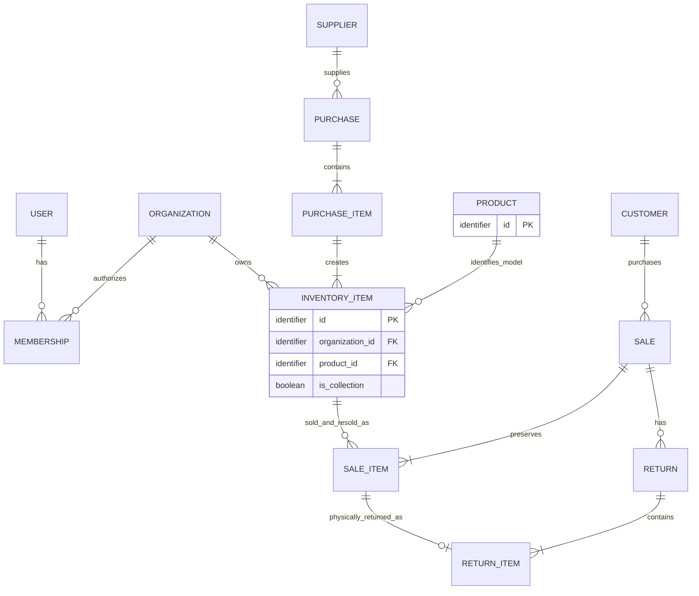
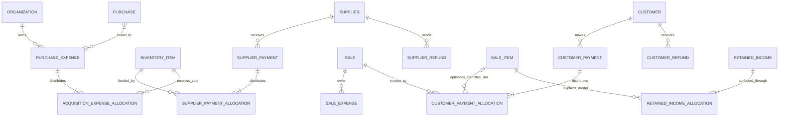

# Estoque164 v0.7 — entity and relationship map

**Version:** 0.7.

**Supersedes:** [Entity and relationship map v0.6](entity-map-v0.6.md).

**Status:** Proposed conceptual model for review, before physical database design.

**Reviewed:** 2026-10-21.

**Revision scope:** PurchaseExpense belongs to an Organization, links to one or more Purchases, and allocates actual cost to selected InventoryItems. Global Product and all other accepted v0.6 decisions carry forward.

**Source:** [Full Requirements Specification v0.7](requirements-v0.7.md), tracked by [#82](https://github.com/WilliamPhilippe/storage-minis-be/issues/82). Historical v0.5/v0.6 snapshots are preserved.

**Related task:** [T01 — core entities, state dimensions, and invariants](https://github.com/WilliamPhilippe/storage-minis-be/issues/21).

**Impact review:** [Shared PurchaseExpense impact](purchase-expense-impact-v0.7.md). [Current ownership index](requirements-coverage-v0.7.md): 307 active IDs. The previous [global Product impact review](global-product-impact-v0.6.md) remains historical.

**Review clarifications:** [Entity-model review](model-review.md). Subsequent user decisions make **Product global and available to every Organization**, name the User/Organization association **Membership**, embed the address on **Customer**, exclude supplier/customer credit balances and a separate LossRecovery entity, link organization-owned PurchaseExpenses to applicable Purchases and keep SaleExpenses owned by their Sale, and place collection membership on **InventoryItem**. Each Organization has one implicit collection, with at most one collection InventoryItem per Product. A shared business/action/audit history supports derived item timelines and financial views. These decisions supersede conflicting v0.5 proposals and requirements; the historical snapshots are preserved.

This map identifies the business information the application must preserve and the relationships needed to explain it. An entity or record type here does not imply a separate SQL table. Embedded values, typed transactions, event details, and normalized tables are physical-design options to evaluate afterward.

The map distinguishes business concepts, required historical/financial information, and conditional storage structures. Discussion IDs remain stable; removed proposals E12, E17, E22, E23, E30, E31, and E38 are intentionally absent. E33–E35 identify derived/history responsibilities rather than separate baseline entities. Record boundaries and database table boundaries are separate decisions.

This map describes conceptual relationships rather than physical SQL tables. The owner subsequently selected PostgreSQL with Drizzle and UTC timestamp storage/reporting; see [Technical direction](technical-direction.md) for the accepted stack, authentication choices, and remaining design outputs. Event sourcing and double-entry accounting are not mandated. D01–D08 remain open; see the linked decision table below. This map records the agreed model, not implemented SQL or resolved policy outcomes.

## 1. Organizations and access

| ID | Entity | Information and responsibility | Main relationships | Requirement basis |
| --- | --- | --- | --- | --- |
| E01 | **Organization** | Ownership and isolation boundary for InventoryItems and operational records, including its single implicit collection. Product catalog records are global. | Has memberships and organization-owned operational records. Every Organization can access the shared Product catalog. No Product ownership or separate Collection entity. | REQ-004; ORG-001–002, ORG-008–009, with Product scope clarified by the user |
| E02 | **User** | Administrator identity and attribution for actions. Google-only Firebase Authentication and ID tokens are accepted; remaining session/bootstrap design follows T02 and the technical direction record. | May have memberships in several Organizations; acts on business events and audit entries. | ORG-003–005; TECH-001 |
| E03 | **Membership** | Connects a User with an Organization and authorized administrative access. | Exactly one User and one Organization per membership. | ORG-003–005, ORG-008; user-confirmed name |

Membership is a recommended association to accommodate the stated future multiple-organization membership. It does not add invitations, a role-management interface, or a separate Permission/Role catalog to launch scope. Users can be global identities. Membership authorizes access to an Organization's operational data; every Organization has access to the global Product catalog.

| Record scope | Ownership and access |
| --- | --- |
| Product | Global identity and shared catalog metadata; no owning `organization_id`. A Product registered through any Organization is available to all Organizations to find, view, and select for their own InventoryItems. |
| User | Global identity, with operational access authorized through Membership. |
| InventoryItem | Exactly one owning Organization and one global Product, represented conceptually by `organization_id` and `product_id`. |
| Customers, Suppliers, Purchases, Sales, funding, expenses, Returns, Losses, and collection membership | Organization-owned operational records. Sharing a Product does not share these records. |

Product is the explicit exception to the broad organization-ownership wording in ORG-002. ORG-008 isolation still applies to each Organization's inventory and operational data. Registering a Product requires no per-Organization copy or separate sharing approval before other Organizations can use that same Product record. The originating Organization does not acquire exclusive ownership of the Product.

## 2. Products and physical units

| ID | Entity | Information and responsibility | Main relationships | Requirement basis |
| --- | --- | --- | --- | --- |
| E04 | **Product** | Global miniature model: internal ID, required name/SKU/brand, optional shared descriptions/images/scale/codes. Registration through one Organization makes its shared catalog record available to all Organizations. SKU is not a unique identity. | No owning Organization or `organization_id`. One Product has many InventoryItems across Organizations. Transactions reach Product through InventoryItem; no Product collection flag or collection-item pointer. | PRO-001–010; user-confirmed global Product scope, access, and relationship boundary |
| E05 | **InventoryItem** | One organization-owned ordered physical unit with its permanent Item ID. Holds current condition, asking price, private notes, ownership/possession and eligibility information, acquisition provenance, cost-finalization information, and collection membership such as `is_collection`. | Exactly one global Product and one owning Organization; one originating PurchaseItem or approved equivalent opening-acquisition source; many historical SaleItems, history facts, expense allocations, and payment allocations in that Organization. | REQ-009, REQ-012; INV-001–031; user-confirmed global Product and item ownership |

Create the Item ID at Purchase registration, including a preorder. Receiving, removal, return, and resale reuse that identity. Sealed/open and damaged/undamaged information must allow the specification's unknown/not-applicable cases. Damage is a condition attribute and does not independently determine availability.

InventoryItem is the connection between a Product and its operational history. A PurchaseItem groups units of the same Product, but a direct PurchaseItem → Product foreign key is not part of this baseline: the Product is reached through its generated InventoryItems. Preserve removed units so the original line's model remains identifiable. Multiple units of the same Product may exist, but at most one may belong to that Organization's collection at a time; collection membership remains optional.

For example, Organization A registers Product P. Organization B can find that same Product P and create its own InventoryItem referring to P without registering a duplicate Product. A's unit and B's unit have separate ownership, condition, asking price, acquisition cost, private notes, and transaction history. Product identity alone never authorizes access to another Organization's units or transactions. Global sharing does not make SKU unique or imply automatic merging of similarly named Products.

Organization-private notes belong to organization-owned records, such as InventoryItem, rather than shared Product metadata. If private annotations at Product/model level are needed independently of a unit, their storage requires an explicit design choice. Shared catalog access for Organizations does not automatically publish all Product data to public visitors: D04 still defines the approved public projection. Permissions for editing an existing shared Product remain open; access to the shared catalog does not by itself settle that policy.

Removing an Organization's eligible unit must not cascade into deletion of its shared Product or invalidate another Organization's references. Any Product editing, archival, deletion, or merge behavior needs an explicit policy that preserves referenced identities and historical facts; this model does not add those workflows. Presentation of historical Product labels after shared metadata changes is also an open policy.

Shared Product metadata changes can affect several Organizations' catalog projections. Invalidate or refresh every affected projection while keeping organization-owned stock, prices, counts, private fields, and financial caches scoped to their Organization. Spreadsheet matching must reuse an approved existing Product identity where appropriate, without treating repeated SKU as a unique key or silently overwriting shared metadata.

The v0.5 first-sale-approval rule preserves the finalized unit cost and its approval date. That information may be fields and preserved source allocations on InventoryItem or a separate cost snapshot; E44 identifies the optional record boundary. Acquisition cost exists independently of sale availability. The review recommends separating cost completeness/finalization from eligibility, so a collection unit never needs to be offered for sale merely to have a meaningful acquisition cost; the finalization policy remains to be confirmed.

## 3. Purchasing and supplier settlement

| ID | Entity | Information and responsibility | Main relationships | Requirement basis |
| --- | --- | --- | --- | --- |
| E06 | **Supplier** | Person/business identity, required name/telephone/type, and purchase relationships. Its balance is derived. | Has Purchases, supplier Payments, Refunds, and applicable adjustments. | SUP-001–012, with supplier-credit references superseded by user clarification |
| E07 | **Purchase** | One Supplier order with lifecycle Open/Completed/Canceled, dates, explicit completion and expense-completeness confirmation. | Exactly one Supplier; has PurchaseItems, related business events, and many-to-many PurchaseExpense links. Expense subtotals derive from its units' allocations. | PUR-001–015, PUR-028–041, PUR-045–046 |
| E08 | **PurchaseItem** | Order line grouping ordered units of one Product, with quantity and total merchandise price. Preserves the source of per-unit merchandise cost. | Exactly one Purchase; generates one InventoryItem per ordered unit. The Product is reached through those units, which must all share the same Product. | PUR-002–007; INV-006; user-confirmed Product linkage |
| E09 | **SupplierPayment** | Actual outgoing supplier merchandise payment: amount, date, method, Supplier, Organization. | Has SupplierPaymentAllocations across specific units, potentially from several Purchases of the same Supplier. | SUP-010–011; PUR-042–044 |
| E10 | **SupplierPaymentAllocation** | Amount of one SupplierPayment assigned to one identified ordered unit. Preserves allocation and correction history. | Exactly one SupplierPayment and InventoryItem; PurchaseItem/Purchase are traceable through the Item. | PUR-034, PUR-042–044 |
| E11 | **SupplierRefund** | Actual money received back from a Supplier, preserving its source and date. An expected refund remains an obligation until actually received. | Exactly one Supplier; links to affected payment/order funding through typed source relationships or settlement-source records. | SUP-009, SUP-011–012; PUR-029–033 |

SupplierPaymentAllocation must resolve to an individual Item ID even if entry is presented as a PurchaseItem allocation. A line-only allocation is insufficient when identical ordered units have different funding and receipt dates.

**Confirmed removal:** SupplierCredit and SupplierCreditApplication are outside the user's business model. Funding before receipt is established by SupplierPayments allocated to the physical unit. Money owed back by a Supplier remains traceable as an unresolved refund/settlement obligation until refunded or explicitly resolved under the loss rules; it is not a reusable supplier-credit balance. SUP-009, SUP-012, PUR-026, PUR-029, and CALC-004 incorporate this decision in v0.6.

## 4. Expenses and acquisition costing

| ID | Entity | Information and responsibility | Main relationships | Requirement basis |
| --- | --- | --- | --- | --- |
| E13 | **PurchaseExpense** | One actual acquisition expense with persistent identity, Organization, amount/date/category/context and settlement information. Shared freight is recorded once. | Exactly one Organization; one or more Purchases in that Organization; has AcquisitionExpenseAllocations to selected InventoryItems. A Purchase may have several PurchaseExpenses. | PUR-016–024, PUR-035, PUR-047–049; FIN-001–002 |
| E14 | **AcquisitionExpenseAllocation** | Amount of one PurchaseExpense assigned directly to one InventoryItem; preserves method, exact result and dated changes. | Exactly one PurchaseExpense and InventoryItem in the same Organization. The unit's originating Purchase must be linked to the expense. All allocations across Purchases reconcile once to its amount. | PUR-018–021, PUR-024, PUR-048–049; INV-011 |
| E15 | **Expense payment information** | Actual settlement amount/date/method for the single expense, independent of how many Purchases it concerns. Embedded fields suffice for a single settlement. | Belongs to the expense; never copied as a cash movement per linked Purchase. Additional payment records remain conditional on an approved partial/batched expense-payment workflow. | PUR-035; FIN-005–006; FIN-001 |
| E45 | **SaleExpense** | Actual selling expense with amount/date/category/context, owned by its Sale. Shown separately here from the former combined E13 row. | Exactly one Sale; remains Sale-level with no unit acquisition allocation. | FIN-002, FIN-004, FIN-009 |

PurchaseExpense is an organization-owned entity with a many-to-many relationship to Purchase. The business relationship is independent of any single Purchase parent. Its links identify acquisition context; amounts are allocated only to InventoryItems. One InventoryItem may receive allocations from several PurchaseExpenses. The same expense/unit pair must not produce duplicate current cost lines; preserved adjustment versions are history.

For P1 containing I1/I2 and P2 containing I3/I4, record one R$30 shipping PurchaseExpense linked to P1/P2 and allocate R$10 to I1 and R$20 to I4. I2/I3 receive none. Derived Purchase subtotals are R$10/R$20 and total cash/expense is R$30 once. Value-proportional, equal-unit and manual allocation use only selected applicable units. A purchase link alone never spreads cost to every unit.

A physical schema may use a unique association such as `PurchaseExpensePurchase(purchase_expense_id, purchase_id)`, or derive Purchase links from unit allocations with equivalent guarantees. This is relationship storage, not a separate expense-allocation target. For a saved fully allocated expense, its Purchase links must match the Purchases represented by its allocated units. Enforce Organization and linkage consistency atomically; do not maintain independent monetary totals on the association.

Receipt checks use the expenses actually allocated to the selected unit. Completion examines that Purchase's units and their shared sources before confirming zero; another Purchase's progress is independent. Completing one Purchase does not freeze eligible changes confined to another Open Purchase, but such changes must preserve source reconciliation, completed-Purchase facts and every approved/sold unit's finalized costs. Removal/cancellation never cascades into deleting shared sources or automatically transferring costs. D06 must settle exceptional correction and unresolved expense disposition; no refund/loss policy is silently adopted.

SaleExpense stays owned by one Sale and reduces Sale net profit once. Shared or separate physical expense tables remain a design choice. General operating-expense entry, a separate ExpensePayment entity and Shipment/package entities are not required by this change. These relationships can be entered through existing Purchase workflows.

## 5. Customers and sales

| ID | Entity | Information and responsibility | Main relationships | Requirement basis |
| --- | --- | --- | --- | --- |
| E16 | **Customer** | Customer identity, contact information, address field(s), notes, and transaction relationships. Debt and refund obligations are derived; no reusable credit balance. | Has Sales, Payments, Refunds, and settlement history. Address is stored directly on Customer, per the user's confirmed decision. | CUS-001–015; PAY-037–038; CUS-016 retired; SAL-004 |
| E18 | **Sale** | Merchandise agreement for exactly one Customer, with dated lifecycle activity, whole-Sale dispatch facts, optional nonunique tracking code, and Sale-level expenses. | Has SaleItems, PaymentAllocations, Returns, and adjustment/settlement events. | SAL-001–028, SAL-036–050; retired SAL-029–035 excluded |
| E19 | **SaleItem** | One specific physical Item committed/sold in a Sale. Preserves agreed unit price, the finalized cost used in recognition, and its active/released/returned history. | Exactly one Sale and InventoryItem; may be referenced by CustomerPaymentAllocations, one physical ReturnItem, retained-income attribution, and financial adjustments. | SAL-001–008, SAL-019, SAL-038–043; INV-007; RET-004, RET-013; CALC-015; user-confirmed line-level funding support |

One InventoryItem can have many SaleItems over its lifetime because of cancellation, edits, Returns, and resale. There may be only one active Sale commitment for it at a time. Do not impose lifetime uniqueness on InventoryItem in SaleItem, or assume one permanent Sale relationship per physical unit.

A Sale's original item/price/cost facts must remain explainable after an edit. Preserve removed SaleItems and post dated changes or preserve versions; do not erase an old SaleItem to represent an exchange. The exact versioning structure follows the history design.

## 6. Customer funding, reallocation, and refunds

| ID | Entity | Information and responsibility | Main relationships | Requirement basis |
| --- | --- | --- | --- | --- |
| E20 | **CustomerPayment** | Actual incoming merchandise amount recognized by the application, with date/method/Customer/Organization. Excludes customer-paid shipping. | Has CustomerPaymentAllocations across existing Sales and, where specified, their SaleItems, all of the same Customer/Organization. | PAY-001–012, PAY-019, PAY-030; FIN-003; user clarification |
| E21 | **CustomerPaymentAllocation** | Amount of a CustomerPayment applied to one Sale, optionally identifying a specific SaleItem within it, including auditable subsequent changes. | Exactly one CustomerPayment and Sale; optional SaleItem must belong to that Sale. Remains traceable through edits, cancellation, reallocation, and Returns. | PAY-002–020, PAY-030; user-confirmed Sale/SaleItem targets |
| E24 | **CustomerRefund** | Actual outgoing money to a Customer, with amount/date and original Sale/transaction provenance. An owed but unpaid refund remains pending settlement, not actual cash or reusable credit. | References the originating Sale and relevant original funding, potentially through several typed source allocations. | PAY-021–029, PAY-033, PAY-036; CUS-011–012, with credit policy superseded |

SupplierPaymentAllocation targets an ordered physical unit. CustomerPaymentAllocation targets a Sale and may identify one of its SaleItems. One conceptual representation is mandatory `sale_id` plus optional `sale_item_id`, enforced to belong to that Sale; the physical design may choose equivalent typed relationships. A line-specific allocation contributes once to its Sale's funding, never as both a Sale allocation and a second line allocation. Sale-level and line-level allocations together must not overfund either applicable obligation.

CustomerRefund cannot be limited to a single original Payment foreign key: a Sale can have several Payments and prior reallocations. Preserve funding provenance across settlement; E36–E37 describe a possible structure. Reassigning an allocation preserves the original CustomerPayment and creates no incoming cash.

**Confirmed removal:** CustomerCredit and CustomerCreditApplication are not supported. New Payments must be fully allocated at entry. When an edit, cancellation, or Return releases a previously allocated amount owed to the Customer, it must be refunded or explicitly reallocated to another eligible existing Sale/SaleItem of that same Customer and Organization as part of resolving the operation. It cannot be parked for an unknown future Sale. RetainedIncome remains a separate, agreed economic outcome for amounts legitimately earned by the business, not customer money held for future use.

A R$40 Payment against a R$100 Sale creates R$60 debt and no credit. A fully paid R$100 Sale later reduced to R$80 frees R$20: refund it or transfer its allocation to an eligible existing Sale/SaleItem. The R$20 cannot be refunded and reallocated simultaneously. If refund disbursement is not instantaneous, preserve an explicit pending refund obligation within the originating settlement, exclude it from available funding, and record actual CustomerRefund cash only when paid. This is a refund obligation, not a wallet. Refund scheduling details remain a workflow choice.

V0.6 incorporates this policy in PAY-012–013, PAY-032–038, CUS-006–015, SAL-021–022, RET-007, ORG-009, and CALC-003. PAY-031 and CUS-016 are retired; PAY-037 owns existing-Sale reassignment and PAY-038 distinguishes pending refunds.

## 7. Returns and retained income

| ID | Entity | Information and responsibility | Main relationships | Requirement basis |
| --- | --- | --- | --- | --- |
| E25 | **Return** | Authorized registration of physically returned units from one original shipped Sale; records date, actor, and the business operation tying inventory and financial effects together. | Exactly one Sale; contains ReturnItems and related settlement/financial events. | RET-001–003, RET-006–012 |
| E26 | **ReturnItem** | One original SaleItem physically received back, with return-time condition and explicit eligibility decision. The original persistent Item ID remains traceable. | Exactly one Return and original SaleItem; that SaleItem identifies the InventoryItem. | RET-004–005, RET-008–009, RET-012–013; INV-028 |
| E27 | **RetainedIncome** | Amount actually received and validly retained after a Sale cancellation/Return or applicable edit, separately from reversed Sale revenue. | References its originating business/settlement event and Sale; has model attribution records. | PAY-024, PAY-033–035; RET-011 |
| E28 | **RetainedIncomeAllocation** | Part of RetainedIncome attributed to an affected SaleItem and therefore its Product/model. | Exactly one RetainedIncome and affected SaleItem; allocations reconcile to the retained total. | PAY-034; COL-020; CALC-015–016 |

A ReturnItem refers to the original SaleItem, not just a Product or an Item ID. This disambiguates returns after the same physical Item has been sold, returned, and sold again. The same original SaleItem cannot have two physical Returns. A later resale creates another SaleItem which may independently be returned.

Cancellation and Return remain different business events. An unshipped cancellation has no ReturnItem or invented physical receipt. Partial Returns only affect the referenced original SaleItems.

RetainedIncome and RetainedIncomeAllocation are accepted. For a paid R$100 Return with R$70 actually refunded and R$30 legitimately retained by agreement, the R$30 is earned income. The original Sale economics are reversed and the retained amount is recognized once. RetainedIncomeAllocation explains which affected model earned that R$30 when several models are involved. The allocation can be represented by income lines instead of a separate header-plus-allocation pair of tables. Retention is never an automatic substitute for refunding customer money.

## 8. Losses and item-level collection membership

| ID | Entity | Information and responsibility | Main relationships | Requirement basis |
| --- | --- | --- | --- | --- |
| E29 | **Loss** | Explicit physical/financial write-off: amount/date/reason, source relationships, and one linked inventory/financial consequence. Preserves any later dated void/reversal. | Relates to the relevant InventoryItem, Purchase, Sale, or lost funding. Actual later refunds reference the original source/Loss where applicable. | LOS-001–008; PUR-031–033; user removal of LossRecovery |

**Collection membership is an InventoryItem property**, such as `InventoryItem.is_collection`. Each Organization has exactly one implicit collection: the set of its designated InventoryItems. There is no Collection entity, collection selector, Product collection flag/pointer, or standalone CollectionDesignation entity in the baseline.

Collection additions/removals preserve their business date, actor, and previous/current membership through shared history. InventoryItem identifies the Product and Organization; no separate Product-to-collection relationship is required. A collection item cannot have an active Sale commitment. Removing membership does not by itself grant sale eligibility or choose a replacement.

**Confirmed cardinality:** within an Organization, at most one InventoryItem of a given Product may have `is_collection = true` at a time, preserving COL-002. Enforce uniqueness of the Organization/Product pair among current collection members, including concurrent designation operations. Changing the designated copy must remove the previous membership before or atomically with adding the replacement, while preserving both dated changes. A Product may have no collection item, and removing one does not select a replacement automatically. Historical cost presentation on membership changes remains D02.

Different Organizations may each designate one of their own units of the same global Product. Collection costs and eligible recovery profit are calculated within the owning Organization, grouping by both Organization and Product. A Sale in Organization A cannot reduce Organization B's collection cost merely because both use the same Product.

**LossRecovery is removed.** The user's delete/remove-loss operation is represented by a dated void/reversal of the Loss and its applicable consequences, preserving audit and prior-period facts. Physical stock consequences must be resolved consistently under the correction rules. A physical Loss and its cost write-off describe the same economic loss and are recorded once.

If actual money is later received, retain its ordinary source record rather than inventing a recovery entity. For example, a R$100 supplier deposit written off and later refunded by R$40 is represented by the original Loss and a linked, dated R$40 SupplierRefund with the appropriate loss adjustment: net loss across both dates is R$60. A void/reversal alone never claims cash was received, and the same adjustment must not be counted again as a second refund or income. No insurance functionality is introduced.

## 9. Required history and financial information

The accepted direction is preserved dated source transactions/adjustments plus **one shared BusinessEvent/action/audit history structure**. Item timelines and financial views derive from those facts. A current-state table plus a generic technical audit log is insufficient unless historical business facts and dates remain reliably queryable.

| ID | Record concept | Information to preserve | Main relationships | Requirement basis |
| --- | --- | --- | --- | --- |
| E32 | **BusinessEvent / shared action history** | A dated administrator business action, its scope, actor, recording time, reason/context, changed facts, typed source references, and adjustment/reversal provenance. Operational actions have an owning Organization; shared Product maintenance requires a distinct global audit scope. | Connects authoritative sources, affected InventoryItems, allocation changes, and settlement consequences. Product registration may retain the actor's Organization as action context without making it the Product owner. Typed details and shared-catalog audit rules follow schema/governance design. | REQ-003, REQ-006–007, REQ-010–012; INV-026; FIN-011; accepted shared history and global Product scope |
| E33 | **ItemHistoryEntry — derived timeline** | Item-specific dated facts: receipt, condition change, approval, hold/release, commitment/release, dispatch, Return, order removal, collection membership, or disposition. | Query/view over InventoryItem-linked source facts and shared history; no independent baseline entity/table. | INV-012–019, INV-026–031; SAL-010; RET-005–009 |
| E34 | **FinancialEffect — derived reporting view** | Dated signed economic components: merchandise revenue, matched unit cost, selling expense, retained income, explicit loss, and adjustments, with attribution through source InventoryItems/SaleItems. | Derives from dated source facts and reversals; no independent editable ledger or mandatory table. | SAL-024–026; FIN-005–012; CALC-006, CALC-010, CALC-015–018 |
| E35 | **AuditEntry — shared-history responsibility** | Who recorded or authorized a change, when, why, and the original/changed facts needed for audit. | Stored with E32's action history and typed details as needed, rather than a second mandatory audit entity/table. | REQ-002–003, REQ-010; SUP-011; PAY-017–020; COL-008 |

FinancialEffect describes required dated reporting information. It can be represented by typed source-event facts or a rigorously derived projection; it does not require an additional independent editable ledger. If financial effects are materialized, they must reconcile to the authoritative sources and must not be counted a second time alongside those sources.

**Accepted implementation direction:** BusinessEvent and AuditEntry share action/history storage with distinct business-date, recorded-time, actor, and change details. ItemHistoryEntry is a timeline query; FinancialEffect is a reporting projection over preserved dated sources. A materialized financial projection is conditional on a demonstrated implementation need. This does not mandate event sourcing or four history tables. Database transactions enforce atomicity; merely recording a BusinessEvent does not make the operation atomic.

Separate **business event date** from **recorded timestamp**. In particular, October Sale recognition and a November reversal remain separate dated facts. A technical audit timestamp alone does not replace that distinction. Decide the representation of corrected original records and links to reversal components under the exceptional correction policy.

## 10. Supporting and conditional design candidates

These records may make the eventual schema clearer. Their existence as separate entities/tables is not approved business scope.

| ID | Candidate | When it is useful | Boundary / unresolved choice |
| --- | --- | --- | --- |
| E36 | **FinancialSettlement** | Groups the resolution of an edit, cancellation, Return, or supplier-order adjustment: affected funding and its refund, reallocation, retained-income, or unrecovered-loss outcomes. Can hold an explicit pending refund obligation, never reusable credit. | Could be typed BusinessEvent details. Keep customer and supplier contexts explicit and preserve actual settlement completion separately from refund percentage. |
| E37 | **SettlementSourceAllocation** | Traces the amount resolved from each original PaymentAllocation into a refund, reallocation to an existing Sale/SaleItem, retention, or write-off. | Typed funding/source relationships can replace a generic entity. Must support several sources without choosing D01's partial-Return allocation order. Avoid unchecked string-based `source_type/source_id` links as the only referential-integrity mechanism. |
| E39 | **OpeningAcquisition** | Provides an explicit acquisition source for imported units that have no reliable historical Purchase records. | Conditional on actual spreadsheet data and the approved migration design. A marked opening Purchase structure is another option. Preserve unknown historical dates and do not fabricate cash transactions. |
| E40 | **ImportBatch** | Identifies a spreadsheet import attempt, source, validation/execution status, actor, and reconciliation results. | Recommended migration-operation record; does not add an ongoing user-facing import-management product. |
| E41 | **ImportRow** | Stores source-row mapping, validation errors, approved assumptions, and created Item/acquisition references; Product is traceable through Item. | Can be a validation artifact instead of a permanent table if it still supports source reconciliation and rerun safety. |
| E42 | **Product image values** | Optional images stored as Product catalog information. | No standalone ProductImage entity in the baseline. Image presentation/storage follows D04 and technical design. |
| E43 | **Brand value** | Required Product field. | No standalone Brand entity or brand-management feature in the baseline. |
| E44 | **ItemCostSnapshot** | Holds the finalized unit acquisition amount, first-approval date/event, and the contributing source/allocation version. | Could be preserved fields and locked allocations on InventoryItem. Snapshot/version records become useful if D06 permits later exceptional cost corrections. |

General shared abstractions such as Party, MoneyTransaction, PaymentMethod, ExpenseCategory, Address, or MediaAsset can be evaluated during physical design. They are not additional business requirements. If money records share storage, retain their distinct meaning and count each actual cash movement once.

Authentication sessions/recovery tokens and backup/deployment metadata belong to technical implementation. No additional inventory-business entity is implied by the authentication, hosting, or daily-backup requirements.

## 11. Core relationship map

This diagram shows the persistent identity and transaction relationships. Product and User are global identities. InventoryItems and operational records belong to the applicable Organization; most ownership edges are omitted, while InventoryItem ownership is shown to explain the boundary. A global Product can identify units owned by different Organizations. Diagram relationships include historical rows, including removed SaleItems and ordered units. Attribute types are conceptual identifiers, not database-engine choices.

For imported units, PURCHASE_ITEM → INVENTORY_ITEM may be replaced by the approved equivalent opening-acquisition relationship. An ordinary ordered unit always has its originating PurchaseItem. Purchase and Sale historical lines are retained even when no active units remain.

An Organization's single collection is its InventoryItems where `is_collection` is true, with at most one such item per Product in that Organization. Membership changes live in shared dated history; a collection table is unnecessary. Every transactional path to Product runs through InventoryItem.

## 12. Payment, cost, and income relationships

Allocation diagrams show the existence and traceability of historical allocations. The **entry-time** requirement is that every new customer or supplier Payment is fully allocated. Later corrections/reclassification must preserve original allocations and their subsequent consequences; this diagram does not require an adjusted Payment to retain the original set of *active* allocations unchanged.

Additional important relationships:

- PurchaseExpense → one or more same-Organization Purchases; AcquisitionExpenseAllocation → selected InventoryItems from those linked Purchases. Purchase-level expense subtotals are derived; the single expense/settlement is never duplicated per Purchase.
- Sale → its SaleExpenses. These expenses have no model-allocation relationship.
- CustomerPaymentAllocation → a Sale and optionally a SaleItem within that Sale; Sale totals count the allocation only once.
- CustomerRefund → original Sale and relevant funding transactions; SupplierRefund → Supplier and original order/payment funding, and Loss when applicable.
- Customer funding reallocation → original allocation and the replacement allocation on an eligible existing Sale/SaleItem. No new cash or credit source is created.
- RetainedIncome → originating settlement/event and Sale; attribution goes through affected SaleItems to Products.
- Shared BusinessEvent history → typed sources, affected InventoryItems, and allocation/settlement consequences.
- Dated source reversal → original source component, enabling partial reversal without destroying history. FinancialEffect is the derived reporting view of these facts.

## 13. Information that is derived rather than an independent source entity

| Concept | Representation |
| --- | --- |
| Reservation | A Sale with positive outstanding balance before dispatch. No separate Reservation entity. |
| In Garage | Derived fully funded, unshipped Sale/Item state. No Garage or stock-location entity. |
| Active Item commitment | Enforced relationship between an InventoryItem and active SaleItem. A separate commitment table is optional, not a second reservation source. |
| Current catalog availability | Organization-scoped projection of physical presence, approval/eligibility, collection/hold/disposition, and active commitment on that Organization's InventoryItems. |
| Public catalog listing | Projection of approved public global Product data and the applicable Organization's eligible InventoryItems. Shared Product access does not expose another Organization's inventory. A merchandising Listing entity is not required. |
| Customer account / balance | View of Sales, Payments, allocations/reallocations, refunds, pending refund obligations, and adjustments. No reusable customer credit or manually editable balance authority. |
| Supplier account / balance | View of active unit commitments, Payments, allocations, Refunds, and adjustments. Supplier credit is excluded by the user's clarification. |
| Purchase payment/receipt progress | Derived from individual active units and their funding/receipt facts, separately from Purchase lifecycle. |
| Sale refund percentage | Derived None/Partial/Full classification, separately from cancellation/Return and settlement-completion state. |
| Inventory/Product quantities | Organization-scoped aggregations of active ordered/on-hand/available/committed/shipped/disposed/removed units, grouped by the global Product where relevant. Product identity does not authorize cross-Organization stock totals. |
| Organization's collection | Its InventoryItems with collection membership set; one implicit collection per Organization and at most one collection item per Product. Product/model totals group these units through InventoryItem.product_id. |
| Item acquisition/landed cost | Merchandise allocation plus applicable actual acquisition-expense allocations; finalized information is preserved at first sale approval. |
| Profit and model/whole-collection recovery | Organization-scoped dated calculations over that Organization's source facts and corrections, grouped by Product for model metrics. No manually maintained Profit or CollectionCost balance entity. |
| Dispatch | Sale-level dispatch facts and event, with optional nonunique tracking code. No independent parcel/carrier/location hierarchy is required. |
| Purchase/Sale cancellation | Typed business event with preserved source and financial consequences; a standalone cancellation header is an optional physical boundary. |
| Approval, hold, receipt, soft removal | Dated item/business facts, which may be typed history records rather than separate aggregate roots. |
| Item timeline and audit view | Queries over preserved dated sources and shared BusinessEvent/action/audit history. |
| Loss removal | Dated void/reversal of Loss and its applicable consequences. No separate LossRecovery entity. |

Derived values can be cached for performance, but source records remain authoritative and caches must reconcile. The public catalog is read-only for visitors.

## 14. Relationship constraints to preserve during schema design

1. Organization-owned operational references stay within one Organization. Product is global: it has no owning Organization, and every Organization can access and reference its shared catalog record regardless of which Organization registered it. An InventoryItem's `product_id` references this global identity, while `organization_id` identifies the owner of the physical unit. Customer funding, reallocation, and refunds also stay within one Customer; supplier allocations stay with the applicable Supplier.
2. An InventoryItem retains its identity, one global Product, one owning Organization, and exactly one valid acquisition provenance in that Organization. Units generated by a PurchaseItem share the same Product; transactions reach that Product through InventoryItem. Do not attempt to validate ownership by matching against a Product organization field.
3. One PurchaseItem generates one physical Item identity per ordered unit. Soft removal retains historical identities and decreases active quantities without deleting source relationships.
4. One physical Item has at most one active Sale commitment, enforced under concurrency. Historical SaleItems and resale remain allowed.
5. One original SaleItem can be physically returned only once. ReturnItem must belong to the same original Sale as its Return header.
6. Supplier payment allocations resolve to individual units; customer payment allocations resolve to Sales and may identify a SaleItem within the same Sale. A line allocation counts once toward Sale funding. Both preserve exact amounts and correction history.
7. At Payment entry, allocations reconcile exactly to the new amount and do not exceed relevant outstanding obligations. Internal reallocations never create cash.
8. Acquisition-expense and retained-income allocations reconcile exactly to their respective source totals, using deterministic BRL rounding. A PurchaseExpense spans one or more same-Organization Purchases; only selected linked units receive cost. Its linked Purchases match its allocated units' Purchases, and allocations reconcile once across all of them. Per-Purchase amounts are derived subtotals, never independent cost targets.
9. No customer funds may remain as reusable credit. Released funding owed back must be refunded or reallocated to an eligible existing Sale/SaleItem, never consumed twice or counted as new cash. Any pending refund is tied to the originating settlement and unavailable for future spending. Debt remains nonnegative.
10. Each Organization has one implicit collection, with membership on InventoryItem and dated changes in shared history. At most one current collection item exists per Organization/Product pair, enforced under concurrency. Collection membership is optional for a Product. A collection item cannot have an active Sale commitment.
11. First approval preserves the finalized cost and blocks ordinary later cost changes; Sale recognition keeps the specific cost basis used. Exceptional correction mechanics remain D06.
12. Physical receipt requires merchandise funding and applicable acquisition expenses to be settled. Receipt does not imply sale approval.
13. Shared-expense changes respect every affected Purchase/unit lock, preserve history and unchanged allocations, and do not cascade-delete shared sources/settlements when a linked unit or Purchase changes. Eligible changes confined to other Open Purchases do not unlock protected facts. Exceptional dispositions remain D06. Purchase cancellation must be rejected if any unit was ever physically received; current stock alone cannot establish eligibility.
14. Each edit, cancellation, Return, Loss, and settlement operation preserves originals and creates all required consequences atomically, once.
15. Original recognition and adjustment dates remain independently queryable. Actual Customer cash timing does not change recognized Sale/collection profit.
16. Removing a Loss preserves a dated void/reversal and resolves applicable stock/financial consequences atomically. An actual later refund uses the existing money-source record; neither reversal nor reporting may duplicate that cash or its economic adjustment.
17. Product sharing never grants access to another Organization's stock, private notes, prices, costs, customers, or transactions. Model quantities, profit, and collection recovery are derived from the applicable Organization's source records; the collection uniqueness key includes both Organization and Product.
18. Removing an eligible InventoryItem preserves the global Product and other Organizations' references. Global metadata changes preserve historical operational facts and refresh affected approved catalog projections; their write permissions and historical label presentation follow an explicit shared-catalog policy.

Some constraints require transaction-level validation as well as foreign keys or unique indexes. This map defines the invariant; engine-specific enforcement belongs to physical schema design.

## 15. Open boundaries before finalizing columns and constraints

| Open topic | Affected records | What remains unresolved |
| --- | --- | --- |
| [D01 — partial-Return funding order](https://github.com/WilliamPhilippe/storage-minis-be/issues/15) | ReturnItem, CustomerPaymentAllocation, settlement-source relationships | Which original Payment allocations are reduced/reclassified first and how amounts are attributed to returned units, particularly where funding was only Sale-level. No reusable credit sources remain. Do not choose FIFO/LIFO implicitly. |
| [D02 — historical collection membership](https://github.com/WilliamPhilippe/storage-minis-be/issues/16) | InventoryItem membership history and report projections | Which historical collection cost is presented after membership changes; a shared history implementation does not settle this reporting policy. |
| [D03 — negative recovery profit](https://github.com/WilliamPhilippe/storage-minis-be/issues/17) | Dated financial source facts and collection projections | Negative eligible profit's treatment in model and pooled recovery formulas. |
| [D04 — catalog contract](https://github.com/WilliamPhilippe/storage-minis-be/issues/18) | Product catalog values and InventoryItem | Exact public fields, image presentation, search, and filters. |
| [D07 — shared Product maintenance and private annotations](https://github.com/WilliamPhilippe/storage-minis-be/issues/79) | Global Product, authorized users, action/audit history, organization-private data | Product registration through an Organization and availability to all Organizations are agreed. Decide permissions and reference preservation for edits or any archival/deletion/merge behavior, global audit scope, historical label presentation, and any private model notes independent of InventoryItem. Catalog access alone does not grant these writes or approve new lifecycle workflows. |
| [D05 — reports and average-cost basis](https://github.com/WilliamPhilippe/storage-minis-be/issues/19) | Cost source/snapshot data and report projections | Launch reports and which costs/units form the average acquisition-price basis. |
| [D06 — exceptional corrections](https://github.com/WilliamPhilippe/storage-minis-be/issues/20) | Cost snapshots, allocations, BusinessEvent, original source records and financial projections | Permitted corrections, authority, version/reversal links, and dated consequences, including valid Loss removal when later activity exists, and shared-expense correction/settlement disposition on linked unit or Purchase removal/cancellation. |
| [D08 — collection costs before any sale approval](https://github.com/WilliamPhilippe/storage-minis-be/issues/80) | InventoryItem cost information and collection membership history | Acquisition cost exists independently of eligibility. The remaining issue is when a never-for-sale collection unit's cost becomes complete/locked, not whether another unit's approval changes its collection cost. A separate completeness/finalization policy is proposed. |
| Legacy acquisition representation and Product matching | OpeningAcquisition or marked opening Purchase structure, import records, global Product identity | Actual spreadsheet evidence, approved treatment of missing acquisition/payment history, matching to existing global Products despite non-unique SKUs, and handling of shared metadata conflicts. |
| Money and business dates | All money, allocation, and dated-history records | BRL, UTC timestamp storage/reporting, and visitor-local timestamp display are accepted. Exact precision/remainder allocation and business-date/recorded-time representation remain T03 work. |

Entity discovery can proceed with these boundaries identified. A subsequent logical-schema pass should choose keys, column ownership, nullability, relationship enforcement, history representation, and indexes, followed by the engine/ORM-specific schema.

## 16. v0.6 → v0.7 change record

| Area | Change |
| --- | --- |
| E13 PurchaseExpense | Independent organization-owned expense identity; links to one or more Purchases instead of one exclusive parent. |
| E14 AcquisitionExpenseAllocation | Direct allocation to selected InventoryItems across linked Purchases; expense reconciliation is global to that source, with no Purchase-header cost allocation. |
| E15 settlement and E45 SaleExpense | Settlement stays once per source. SaleExpense is shown separately from the former combined E13 row, retaining its unchanged Sale-level responsibility. No retired entity ID is reused. |
| Relationship diagram and constraints | Many-to-many Purchase context, same-Organization integrity, unit eligibility, derived subtotals, preserved shared sources and all affected locks. |
| Traceability and open policies | PUR-047–049 added; 307 active requirements. D01–D08 remain open, with shared-expense exceptional disposition included under D06. |

All other accepted v0.6 model decisions carry forward. Historical maps and requirements remain unchanged; see the [v0.6 change record](entity-map-v0.6.md#16-v05--v06-change-record).
