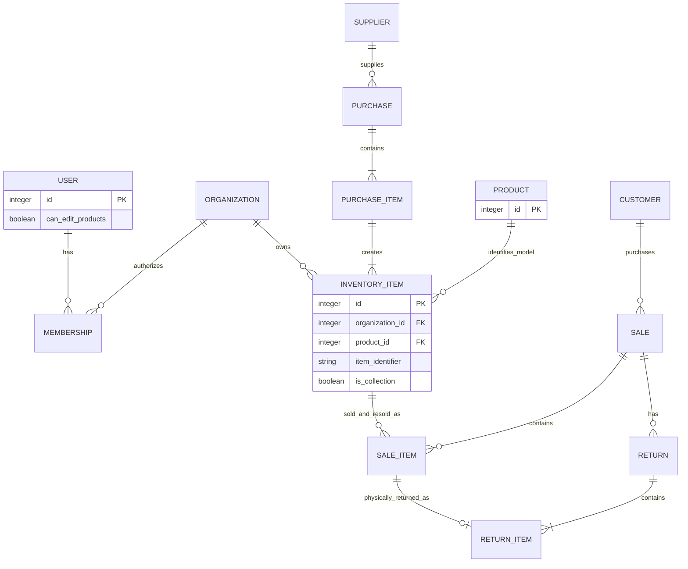
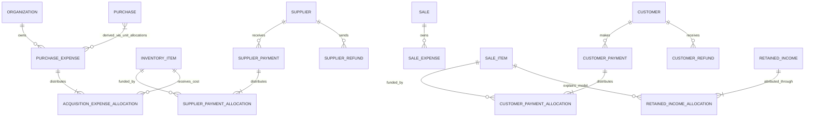
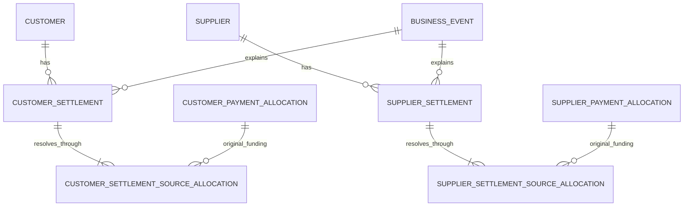

# Estoque164 v0.8 — entity and relationship map

**Version:** 0.8. **Reviewed:** 2026-10-22.

**Supersedes:** [Entity and relationship map v0.7](entity-map-v0.7.md). Historical maps remain unchanged.

**Status:** Conceptual consolidation of the existing model and owner-approved schema-review decisions. Physical schema design and implementation remain pending.

**Approval source:** WilliamPhilippe's answers to Q1–Q61, approved on 2026-10-22 and recorded in the [schema-review update log](requirement-updates/2026-10-22-schema-review.md). Later answers in that log supersede earlier proposals.

**Revision scope:** Integer identities and centavos; UTC occurrence timestamps; original-period report recalculation; SaleItem deletion and permanent locks; mandatory item-level customer funding; separate customer/supplier settlement storage; allocation-derived PurchaseExpense links; collection costs/recovery; global Product-edit authority; and the public catalog contract. Section 16 compares v0.7 with the approved replacements.

**Source precedence:** Read the [requirements v0.7](requirements-v0.7.md) together with the approved update log. The log supersedes conflicting v0.7 wording for its covered topics; unaffected requirements remain applicable. Requirement IDs below retain their v0.7 traceability and existing delivery owners.

**Publication scope:** This publishes the next entity map only, not a complete v0.8 requirements baseline. The requirements specification, ownership index, [DBML draft](database/schema.dbml), [database design guide](database/design.md), and GitHub issue acceptance criteria still need reconciliation. [#82](https://github.com/WilliamPhilippe/storage-minis-be/issues/82) remains the published v0.7 baseline tracker; no delivery or decision issue is closed by this document.

**Related task:** [T01 — core entities, state dimensions, and invariants](https://github.com/WilliamPhilippe/storage-minis-be/issues/21).

**Prior traceability:** [Shared PurchaseExpense impact v0.7](purchase-expense-impact-v0.7.md) and [ownership index v0.7](requirements-coverage-v0.7.md), with 307 active requirement IDs and nine retired IDs. No requirement IDs or primary delivery owners are changed here.

**Carried-forward decisions:** Product is global and available to every Organization; Membership authorizes operational access; Customer embeds its address; supplier/customer credit balances and LossRecovery are excluded; PurchaseExpense is Organization-owned and SaleExpense is Sale-owned; collection membership belongs to InventoryItem, with at most one current unit per Organization/Product. One shared BusinessEvent/action/audit history supports derived item timelines and financial views. The [earlier entity-model review](model-review.md) supplies rationale where not superseded by the schema-review log.

This map identifies the business information the application must preserve and the relationships needed to explain it. An entity or record type here does not imply a separate SQL table. Embedded values, typed transactions, event details, and normalized tables are physical-design options to evaluate afterward.

The map distinguishes business concepts, required historical/financial information, approved storage choices, and conditional candidates. Discussion IDs remain stable; removed proposals E12, E17, E22, E23, E30, E31, and E38 remain retired and are not reused. E33–E35 identify derived/history responsibilities. E36–E37 retain their settlement-header and source-allocation responsibilities, now explicitly separated into customer and supplier record families; they no longer propose generic mixed-party tables.

PostgreSQL with Drizzle remains selected; see [Technical direction](technical-direction.md) for the stack and authentication choices, applying the later log for money and dates. Integer keys, integer centavos, and four dedicated settlement structures are now approved design inputs. Other table boundaries, constraints, and transaction/concurrency enforcement remain T01/T06 work. Event sourcing and double-entry accounting are not mandated. Section 15 separates approved policy from remaining decisions without treating every D01–D08 topic as unresolved.

## 1. Organizations and access

| ID | Entity | Information and responsibility | Main relationships | Requirement basis |
| --- | --- | --- | --- | --- |
| E01 | **Organization** | Ownership and isolation boundary for InventoryItems and operational records, including its single implicit collection. Product catalog records are global. | Has memberships and organization-owned operational records. Every Organization can access the shared Product catalog. No Product ownership or separate Collection entity. | REQ-004; ORG-001–002, ORG-008–009, with Product scope clarified by the user |
| E02 | **User** | Global identity and action attribution; global `can_edit_products` permission, denied by default and granted to the initial administrator during bootstrap. Google-only Firebase Authentication and ID tokens remain selected. | May have memberships in several Organizations; acts on business events and audit entries. Global Product-edit authority is independent of Organization membership. | ORG-003–005; TECH-001; Q35, Q39–Q40 |
| E03 | **Membership** | Connects a User with an Organization and authorized administrative access. | Exactly one User and one Organization per membership. | ORG-003–005, ORG-008; user-confirmed name |

Membership is the accepted User–Organization association. It does not add invitations, a role-management interface, or a separate Permission/Role catalog to launch scope. Membership authorizes access to an Organization's operational data; every Organization has access to the global Product catalog. Authorized Organization administrators can register new Products without `can_edit_products`; editing any existing shared Product requires that global User permission. Remaining session and bootstrap mechanics stay with T02.

| Record scope | Ownership and access |
| --- | --- |
| Product | Global identity and shared catalog metadata; no owning `organization_id`. A Product registered through any Organization is available to all Organizations to find, view, and select for their own InventoryItems. |
| User | Global identity and Product-edit permission, with operational access authorized through Membership. |
| InventoryItem | Exactly one owning Organization and one global Product, represented conceptually by `organization_id` and `product_id`. |
| Customers, Suppliers, Purchases, Sales, funding, expenses, Returns, Losses, and collection membership | Organization-owned operational records. Sharing a Product does not share these records. |

Product is the explicit exception to the broad organization-ownership wording in ORG-002. ORG-008 isolation still applies to each Organization's inventory and operational data. Registering a Product requires no per-Organization copy or separate sharing approval before other Organizations can use that same Product record. The originating Organization does not acquire exclusive ownership of the Product.

## 2. Products and physical units

| ID | Entity | Information and responsibility | Main relationships | Requirement basis |
| --- | --- | --- | --- | --- |
| E04 | **Product** | Global miniature model: integer internal ID, required name/SKU/brand, optional shared descriptions/images/scale/codes. Registration makes the record available to all Organizations. SKU is not unique. Historical screens use current shared metadata. | No owning Organization or `organization_id`. Has InventoryItems across Organizations. Transactions reach Product through InventoryItem; shared edits require global User permission and audit. | PRO-001–010, PRO-012–013; Q35, Q39–Q41 |
| E05 | **InventoryItem** | One Organization-owned ordered physical unit with integer database ID and a separate permanent human-readable `itemIdentifier` / `item_identifier`. Holds condition, optional asking price, private notes, optional public unit description/photos, possession, eligibility, acquisition provenance, permanent cost-finalization information, and collection membership such as `is_collection`. | Exactly one global Product and owning Organization; one PurchaseItem or approved equivalent opening-acquisition source; many historical SaleItems, history facts, expense allocations, and supplier payment allocations. | REQ-009, REQ-012; INV-001–031; Q22, Q26, Q31, Q36, Q47, Q49–Q51, Q54 |

Use integer database primary/foreign keys throughout. Automatically assign the separate human-readable Item identifier at ordinary Purchase registration, including preorders. `ITEM-000001` is the approved example format. It is immutable, unique within its Organization, never reused, and may have gaps. Receipt, soft removal, Sale, Return, and resale retain the same physical identity and identifier. Integer widths/generators remain T01/T06 choices; legacy identifier mapping remains T05 work.

Sealed/open and damaged/undamaged information must allow the specification's unknown/not-applicable cases. Damage is a condition attribute and does not independently determine availability. Asking price is optional; it does not substitute for the agreed SaleItem price.

InventoryItem is the connection between a Product and its operational history. A PurchaseItem groups units of the same Product, but a direct PurchaseItem → Product foreign key is not part of this baseline: the Product is reached through its generated InventoryItems. Preserve removed units so the original line's model remains identifiable. Multiple units of the same Product may exist, but at most one may belong to that Organization's collection at a time; collection membership remains optional.

For example, Organization A registers Product P. Organization B can find that same Product P and create its own InventoryItem referring to P without registering a duplicate Product. A's unit and B's unit have separate ownership, condition, asking price, acquisition cost, private notes, and transaction history. Product identity alone never authorizes access to another Organization's units or transactions. Global sharing does not make SKU unique or imply automatic merging of similarly named Products.

Organization-private descriptions/notes belong on InventoryItem. No separate private Product/model annotation structure is needed. Optional public unit descriptions and photos are distinct from private notes and shared Product metadata. Organization administrators manage their own unit photos without global Product-edit permission. The approved public projection and its remaining D04 details are described in Section 13.

Removing an Organization's eligible unit must preserve its shared Product and other Organizations' references. Authorized edits to existing shared Products retain global metadata audit; historical transaction screens display current Product metadata, without requiring old name/brand/image snapshots for presentation. Monetary and physical transaction facts remain protected. Product merge/archive/deletion/moderation workflows are not added by the edit permission.

Shared Product metadata changes can affect several Organizations' catalog projections. Invalidate or refresh every affected projection while keeping organization-owned stock, prices, counts, private fields, and financial caches scoped to their Organization. Spreadsheet matching must reuse an approved existing Product identity where appropriate, without treating repeated SKU as a unique key or silently overwriting shared metadata.

Cost completeness/finalization is independent of sale eligibility. First sale approval finalizes ordinary units. A never-for-sale collection unit can explicitly finalize once its actual merchandise cost and applicable expenses are complete and settled. Finalization permanently locks merchandise costs and acquisition-expense allocations; removing approval or collection membership never unlocks them. Preserve the finalization time/trigger and sources as fields with locked allocations or an optional E44 snapshot. Display known actual costs and recovery as provisional before finalization, without inventing missing expenses.

## 3. Purchasing and supplier settlement

| ID | Entity | Information and responsibility | Main relationships | Requirement basis |
| --- | --- | --- | --- | --- |
| E06 | **Supplier** | Person/business identity, required name/telephone/type, and purchase relationships. Its balance is derived. | Has Purchases, supplier Payments, Refunds, and supplier settlements. | SUP-001–012, with supplier-credit references superseded |
| E07 | **Purchase** | One Supplier order with lifecycle Open/Completed/Canceled, occurrence timestamps, explicit completion and expense-completeness confirmation. Completed Purchases are firmly locked against corrections. | Exactly one Supplier; has PurchaseItems and business history. PurchaseExpense links and subtotals derive through its units' allocations. | PUR-001–015, PUR-028–041, PUR-045–046; Q3, Q57 |
| E08 | **PurchaseItem** | Order line grouping ordered units of one Product, with quantity and total merchandise price. Preserves the source of per-unit merchandise cost. | Exactly one Purchase; generates one InventoryItem per ordered unit. The Product is reached through those units, which must all share the same Product. | PUR-002–007; INV-006; user-confirmed Product linkage |
| E09 | **SupplierPayment** | Actual outgoing supplier merchandise payment: amount, date, method, Supplier, Organization. | Has SupplierPaymentAllocations across specific units, potentially from several Purchases of the same Supplier. | SUP-010–011; PUR-042–044 |
| E10 | **SupplierPaymentAllocation** | Amount of one SupplierPayment assigned to one identified ordered unit. Preserves allocation and correction history. | Exactly one SupplierPayment and InventoryItem; PurchaseItem/Purchase are traceable through the Item. | PUR-034, PUR-042–044 |
| E11 | **SupplierRefund** | Actual money received back from a Supplier, preserving its funding provenance and actual UTC occurrence timestamp. An expected refund remains an obligation until received; a chosen refund is settled once without installments. | Exactly one Supplier; links to original payment/order funding through supplier settlement sources and to the original Loss when applicable. | SUP-009, SUP-011–012; PUR-029–033; Q8, Q12, Q45, Q60–Q61 |

SupplierPaymentAllocation must resolve to an individual Item ID even if entry is presented as a PurchaseItem allocation. A line-only allocation is insufficient when identical ordered units have different funding and receipt dates.

**Confirmed removal:** SupplierCredit and SupplierCreditApplication are outside the user's business model. Funding before receipt is established by SupplierPayments allocated to the physical unit. Money owed back by a Supplier remains traceable as an unresolved refund/settlement obligation until refunded or explicitly resolved under the loss rules; it is not a reusable supplier-credit balance. SUP-009, SUP-012, PUR-026, PUR-029, and CALC-004 incorporate this decision in v0.6.

## 4. Expenses and acquisition costing

| ID | Entity | Information and responsibility | Main relationships | Requirement basis |
| --- | --- | --- | --- | --- |
| E13 | **PurchaseExpense** | One actual positive acquisition expense with persistent identity, Organization, amount/date/category/context and settlement information. Shared freight is recorded once. | Exactly one Organization; has selected InventoryItem allocations. Its one-or-more Purchase links derive exclusively from those units' originating Purchases. | PUR-016–024, PUR-035, PUR-047–049; FIN-001–002; Q3, Q14 |
| E14 | **AcquisitionExpenseAllocation** | Exact centavo amount of one PurchaseExpense assigned directly to one InventoryItem, with method, result, and dated changes. Locks permanently with unit cost finalization. | Exactly one PurchaseExpense and InventoryItem in the same Organization. Determines the linked Purchase through the unit; all source allocations reconcile once across Purchases. | PUR-018–021, PUR-024, PUR-048–049; INV-011; Q3, Q7, Q17, Q31, Q44 |
| E15 | **Expense payment information** | Actual settlement amount/date/method for the single expense, independent of how many Purchases it concerns. Embedded fields suffice for a single settlement. | Belongs to the expense; never copied as a cash movement per linked Purchase. Additional payment records remain conditional on an approved partial/batched expense-payment workflow. | PUR-035; FIN-005–006; FIN-001 |
| E45 | **SaleExpense** | Actual positive selling expense with amount/date/category/context, owned by its Sale. Recording and settlement remain allowed after dispatch, cancellation, or Return. | Exactly one Sale; no model/unit acquisition allocation. Reduces its original-period Sale net result once, retaining actual expense and cash timestamps. | FIN-002, FIN-004, FIN-009; Q42, Q58–Q59 |

PurchaseExpense is Organization-owned with a derived many-to-many relationship to Purchase, independent of any exclusive Purchase parent. Amounts are allocated only to InventoryItems. One unit may receive allocations from several PurchaseExpenses; the same expense/unit pair must not produce duplicate current cost lines. Preserve allocation changes in history.

For P1 containing I1/I2 and P2 containing I3/I4, record one R$30 shipping PurchaseExpense linked to P1/P2 and allocate R$10 to I1 and R$20 to I4. I2/I3 receive none. Derived Purchase subtotals are R$10/R$20 and total cash/expense is R$30 once. Value-proportional, equal-unit and manual allocation use only selected applicable units. A purchase link alone never spreads cost to every unit.

Derive Purchase links from AcquisitionExpenseAllocation → InventoryItem → PurchaseItem → Purchase. The independently maintained `purchase_expense_purchases` association is rejected. For a saved, fully allocated expense, linked Purchases are exactly the distinct Purchases represented by its allocated units. Enforce Organization/acquisition consistency, source reconciliation, and historical explainability atomically. Purchase subtotals remain derived, without Purchase-header cost allocations.

Use integer centavos and exact proportional/equal-unit arithmetic with largest fractional remainders; permanent Item ID breaks ties, never screen order. R$100 across three equally weighted units produces 3334, 3333, 3333 centavos. If every selected merchandise value is zero, require explicit equal-unit or manual allocation instead of silently changing a proportional method. Confirmed-zero expenses are completeness facts, distinct from unknown expenses and from actual positive expense sources.

Receipt checks use each unit's applicable settled expenses and full merchandise funding; receipt alone does not grant sale approval. Completion examines its remaining active units and shared sources before confirming expenses complete or zero. Completed Purchases reject corrections. Eligible shared-expense changes confined to other Open Purchases may proceed while preserving completed-Purchase facts, unaffected allocations, source reconciliation, and all finalized costs.

An acquisition-expense allocation blocks ordinary removal of an unreceived Purchase unit even if no merchandise payment exists. Resolve the allocation explicitly before removal; merchandise funding must also be resolved. Preserve the shared expense, settlement, and unaffected allocations. Neither unit/Purchase removal nor cancellation automatically deletes the shared source or redistributes its cost. D06 retains exceptional disposition where ordinary permitted resolution is insufficient; no automatic refund, write-off, transfer, or unlock is selected.

SaleExpense stays owned by one Sale and reduces Sale net profit once, including after cancellation/Return. An expense incurred/recorded later contributes to the original Sale period while its expense/cash views use actual occurrence/payment times. This is an approved exception to the post-dispatch agreement lock. Shared or separate physical expense tables remain a design choice. General operating-expense entry, a separate ExpensePayment entity, expense-payment batching, and Shipment/package entities are not added.

## 5. Customers and sales

| ID | Entity | Information and responsibility | Main relationships | Requirement basis |
| --- | --- | --- | --- | --- |
| E16 | **Customer** | Requires a nonblank name; phone and address are optional. Holds private notes and transaction relationships. Debt and refund obligations are derived; no reusable credit balance. | Has Sales, Payments, Refunds, and customer settlements. Address is stored directly on Customer. | CUS-001–015; PAY-037–038; SAL-004; CUS-016 remains retired; Q46 |
| E18 | **Sale** | Merchandise agreement for exactly one Customer, with occurrence time, lifecycle activity, whole-Sale dispatch, optional nonunique tracking code, and Sale-level expenses. Dispatch permanently locks agreement corrections. | Has SaleItems, Returns, customer settlements, and history. Payments reach the Sale through mandatory SaleItem allocations. | SAL-001–028, SAL-036–050; retired SAL-029–035 excluded; Q10–Q11, Q15, Q18, Q24, Q58 |
| E19 | **SaleItem** | One specific physical unit in a Sale, with agreed price, finalized acquisition cost, and commitment/Return facts. Only never-funded, unshipped lines may be operationally deleted. | Exactly one Sale and InventoryItem; funding allocations, at most one ReturnItem, and retained-income attribution. Audit must remain explainable after permitted deletion. | SAL-001–008, SAL-019, SAL-038–043; INV-007; RET-004, RET-013; CALC-015; Q13, Q16, Q19–Q20, Q23–Q25, Q56 |

One InventoryItem can have many SaleItems over its lifetime because of cancellation, edits, Returns, and resale. There may be only one active Sale commitment for it at a time. Do not impose lifetime uniqueness on InventoryItem in SaleItem, or assume one permanent Sale relationship per physical unit.

A Sale's original and corrected facts remain explainable through shared before/after audit. Every permitted pre-dispatch item/price edit is a correction of the original Sale, not a separate later-agreement workflow. Reports recompute that Sale's original period from current corrected sources.

Only a SaleItem that has never received positive funding can be deleted, and only before dispatch. Any partial funding permanently blocks deletion, even after refund or reassignment removes all currently applied funding. A funded line can undergo permitted pre-dispatch price correction/settlement while retaining its identity and funding history. Delete an eligible operational line and the Sale-related dependent records it generated atomically; retain action audit, Sale/physical Item context, and surviving shared source facts. Actual cash/expense records must remain explainable. Reintroducing the physical unit creates a new SaleItem ID with the same InventoryItem. An emptied Sale becomes Canceled rather than disappearing.

An active unshipped Sale with debt is Reserved; zero debt makes it In Garage automatically. Dispatch is explicit at Sale level and permanently locks agreed lines/prices and shipment status against correction. A physical Return is the subsequent Sale lifecycle operation. Recording/settling actual SaleExpenses remains explicitly allowed after dispatch without changing the agreement. Cancellation is pre-dispatch; Return requires physical receipt of shipped units and a condition/eligibility decision.

## 6. Customer funding, reallocation, and refunds

| ID | Entity | Information and responsibility | Main relationships | Requirement basis |
| --- | --- | --- | --- | --- |
| E20 | **CustomerPayment** | Actual incoming merchandise money with occurrence timestamp, method, Customer, and Organization. Excludes customer-paid shipping. | Has allocations to one or more SaleItems, potentially across multiple existing Sales of the same Customer/Organization. Multiple Payments may fund one SaleItem. | PAY-001–012, PAY-019, PAY-030; FIN-003; Q24, Q27 |
| E21 | **CustomerPaymentAllocation** | Exact amount of one CustomerPayment applied to exactly one SaleItem, with auditable subsequent changes. Sale-level-only allocation is disallowed. | Exactly one CustomerPayment and SaleItem; reaches the Sale through that line. A redundant Sale/scope key, if retained, must match that line. | PAY-002–020, PAY-030; Q24, Q27 supersede optional attribution in v0.7 PAY-003/E21 |
| E24 | **CustomerRefund** | Actual outgoing money with amount, actual occurrence time, and original funding provenance. One chosen refund amount is paid in one cash transaction; pending obligations are separate from cash. | References the originating Sale/settlement and one or more original funding sources through customer settlement source allocations. | PAY-021–029, PAY-033, PAY-036; CUS-011–012; Q8, Q12, Q25, Q28, Q61 |

SupplierPaymentAllocation targets an ordered physical unit; CustomerPaymentAllocation always targets a SaleItem. The line's Sale, Customer, and Organization must match the Payment's scope. One Payment can fund several SaleItems across several Sales of the same Customer/Organization, and one line can receive several Payments. Enforce source and line obligation limits and derive Sale funding once from its lines. Optional line attribution in v0.7 is superseded.

CustomerRefund cannot be limited to a single original Payment foreign key: a SaleItem may have several Payments and prior reallocations. E36–E37 now require separate customer/supplier settlement headers and source allocations. Reassigning funding preserves the original Payment and allocation provenance and creates no incoming cash or profit.

**Confirmed removal:** CustomerCredit and CustomerCreditApplication are not supported. New Payments must be fully allocated at entry. Released money owed to the Customer must be refunded or explicitly reassigned to eligible existing SaleItems of that same Customer and Organization as part of resolving the operation. It cannot be parked for an unknown future Sale. RetainedIncome is a separate agreed economic outcome for money legitimately earned by the business.

A R$40 Payment against a R$100 Sale creates R$60 debt and no credit. A fully paid R$100 Sale corrected to R$80 frees R$20: refund it or reassign it to an eligible existing SaleItem. The same R$20 cannot be consumed twice. If payment of a refund is pending, preserve a source-linked obligation in its settlement, unavailable for future spending, and record cash only when actually paid.

Refunds consume applicable original funding from the oldest Payment to the newest; do not distribute refund provenance proportionally. A R$70 refund against an item funded by older R$40 and newer R$60 Payments consumes R$40 from the older and R$30 from the newer Payment. Equal-time tie-breaking and source ordering for non-refund outcomes remain to be specified.

A chosen refund can be less than the original Payment but cannot be paid in installments. For example, resolve a paid R$100 Return as one R$70 refund and R$30 legitimate retained income. The R$70 can remain explicitly pending and then be paid once; the remaining R$30 has its own reconciled outcome. Do not confuse a partial refund amount or None/Partial/Full refund classification with partial disbursement of one chosen obligation.

The no-wallet policy remains traced to PAY-012–013, PAY-032–038, CUS-006–015, SAL-021–022, RET-007, ORG-009, and CALC-003. PAY-031 and CUS-016 remain retired; PAY-037 owns existing-Sale reassignment and PAY-038 distinguishes pending refunds. The approved review narrows all customer allocation targets to SaleItems without changing delivery ownership.

## 7. Returns and retained income

| ID | Entity | Information and responsibility | Main relationships | Requirement basis |
| --- | --- | --- | --- | --- |
| E25 | **Return** | Authorized physical return from one original shipped Sale, with its own occurrence/recording times and actor. Recomputes returned merchandise contribution in the original Sale period. | Exactly one Sale; contains ReturnItems, customer settlement consequences, and shared history. | RET-001–003, RET-006–012; Q21, Q25 |
| E26 | **ReturnItem** | One original SaleItem physically received back, with return-time condition and explicit eligibility decision. The original persistent Item ID remains traceable. | Exactly one Return and original SaleItem; that SaleItem identifies the InventoryItem. | RET-004–005, RET-008–009, RET-012–013; INV-028 |
| E27 | **RetainedIncome** | Received money validly retained after cancellation/Return or applicable correction, separate from removed merchandise revenue and attributed to the original Sale period. | References its originating customer settlement/event and Sale; has reconciled model attribution. | PAY-024, PAY-033–035; RET-011; Q12, Q29 |
| E28 | **RetainedIncomeAllocation** | Part of RetainedIncome attributed to an affected SaleItem and therefore its Product/model. | Exactly one RetainedIncome and affected SaleItem; allocations reconcile to the retained total. | PAY-034; COL-020; CALC-015–016 |

A ReturnItem refers to the original SaleItem, not just a Product or an Item ID. This disambiguates returns after the same physical Item has been sold, returned, and sold again. The same original SaleItem cannot have two physical Returns. A later resale creates another SaleItem which may independently be returned.

Cancellation and Return remain different business events. An unshipped cancellation has no ReturnItem or invented physical receipt. Partial Returns only affect the referenced original SaleItems.

RetainedIncome and RetainedIncomeAllocation remain accepted. For a paid R$100 Return with R$70 refunded and R$30 legitimately retained, remove the returned line's revenue and matched acquisition-cost contribution from the original Sale period, then include R$30 retained income once in that same period. The actual R$70 refund belongs to its actual cash date and does not reverse profit again. Partial Returns change only their affected lines. Sale-level expenses remain counted after Return/cancellation, including a negative net result when no merchandise profit remains.

RetainedIncomeAllocation explains which affected model earned the retained amount when several models are involved. Income lines can represent the attribution without a separate header/allocation pair of tables. Preserve source funding through the dedicated customer settlement records. Retention is never an automatic substitute for refunding customer money.

## 8. Losses and item-level collection membership

| ID | Entity | Information and responsibility | Main relationships | Requirement basis |
| --- | --- | --- | --- | --- |
| E29 | **Loss** | Explicit physical/financial write-off with amount, occurrence time, reason, and source links; one economic write-off with auditable correction/removal. Reports derive its current net result in the original Loss period. | Relates to InventoryItem, Purchase, Sale, or lost funding as applicable. Actual SupplierRefunds retain original source/Loss provenance and actual cash times. | LOS-001–008; PUR-031–033; Q45, Q60 |

**Collection membership is an InventoryItem property**, such as `InventoryItem.is_collection`. Each Organization has exactly one implicit collection: the set of its designated InventoryItems. There is no Collection entity, collection selector, Product collection flag/pointer, or standalone CollectionDesignation entity in the baseline.

Collection additions/removals preserve their occurrence/recording timestamps, actor, and previous/current membership through shared history. InventoryItem identifies the Product and Organization; no separate Product-to-collection relationship is required. A collection item cannot have an active Sale commitment. Removing membership does not by itself grant sale eligibility or choose a replacement.

**Confirmed cardinality:** within an Organization, at most one InventoryItem of a given Product may have `is_collection = true` at a time, preserving COL-002. Enforce uniqueness of the Organization/Product pair under concurrent changes. Replacement removes the previous membership before or atomically with adding the new one, preserving both dated changes. A Product may have no collection item; removal selects no replacement automatically. Metrics use current membership. Past-date collection-designation/cost reporting is not required; ordinary membership audit is retained.

Different Organizations may each designate one of their own units of the same global Product. Collection costs and eligible recovery profit are calculated within the owning Organization, grouping by both Organization and Product. A Sale in Organization A cannot reduce Organization B's collection cost merely because both use the same Product.

Acquisition cost and recovery are distinct: R$120 known actual costs minus R$40 eligible profit gives R$80 provisional net collection cost. Display known costs and recovery as provisional until complete/finalized; missing expenses remain unknown. Finalized acquisition cost is permanently locked while recovery continues changing with eligible booked profit, independently of customer-payment timing.

Include signed negative eligible profit in both per-model and pooled recovery. A current R$100 collection unit with R$20 negative model profit has R$120 net model collection cost. A R$200 collection base with R$60 profit and R$20 loss gives R$160 pooled net collection cost before other applicable expenses. Preserve the zero floor and separately visible excess profit. Per-model gross profit plus attributed retained income and pooled Organization recovery remain separate calculations; Sale-level selling expenses stay at Sale level, and excess model profit does not transfer to another individual model. Qualifying Sales before designation may still contribute under COL-018.

**LossRecovery remains removed.** Removing a mistaken Loss records an auditable dated void/correction and removes its contribution from the original Loss period. Preserve the original facts and correction history even though the report result changes. Resolve physical stock consistently with later activity; a physical Loss and its write-off are the same economic loss, counted once. Removal alone implies no cash receipt.

Actual later money retains its ordinary source record. An October R$100 supplier-funding Loss followed by a November R$40 SupplierRefund produces October net Loss R$60 and November incoming cash R$40. The linked refund reduces the original Loss result once; no independent signed-adjustment transaction or duplicate income is created. Exceptional stock/expense disposition remains D06; insurance functionality is not introduced.

## 9. Required history and financial information

The accepted direction is typed, queryable source/change facts plus **one shared BusinessEvent/action/audit history structure**, including before/after information. Item timelines and financial views derive from those facts. Corrections update the reportable source result; they do not create independent generic signed financial-adjustment transactions. A generic technical audit timestamp alone cannot explain the business facts.

| ID | Record concept | Information to preserve | Main relationships | Requirement basis |
| --- | --- | --- | --- | --- |
| E32 | **BusinessEvent / shared action history** | Administrator action with actual occurrence timestamp, distinct recording timestamp, actor, scope, reason/context, before/after facts, typed source links, and correction/reversal provenance. Operational history is Organization-owned; shared Product maintenance has global audit scope. | Connects sources, physical Items, funding changes, and settlements. Retains explanatory Sale/Item context after permitted SaleItem deletion. Product action context does not establish Product ownership. | REQ-003, REQ-006–007, REQ-010–012; INV-026; FIN-011; Q1, Q5–Q6, Q10–Q11, Q16, Q20, Q41 |
| E33 | **ItemHistoryEntry — derived timeline** | Item-specific dated facts: receipt, condition change, approval, hold/release, commitment/release, dispatch, Return, order removal, collection membership, or disposition. | Query/view over InventoryItem-linked source facts and shared history; no independent baseline entity/table. | INV-012–019, INV-026–031; SAL-010; RET-005–009 |
| E34 | **FinancialEffect — derived reporting view** | Current source-derived revenue, matched acquisition cost, Sale expenses, retained income, and net Loss, attributed to original Sale/Loss periods; actual cash retains its occurrence date. | Query/projection over authoritative typed sources and their correction/Return/settlement links. No independent generic adjustment transaction or stored monthly report entity. | SAL-024–026; FIN-005–012; CALC-006, CALC-010, CALC-015–018; Q10–Q11, Q21, Q25, Q29, Q42, Q45, Q58–Q60 |
| E35 | **AuditEntry — shared-history responsibility** | Who recorded or authorized a change, when, why, and the original/changed facts needed for audit. | Stored with E32's action history and typed details as needed, rather than a second mandatory audit entity/table. | REQ-002–003, REQ-010; SUP-011; PAY-017–020; COL-008 |

FinancialEffect is a reporting responsibility. Derived components may have signed values, but no separate generic signed-adjustment money source is introduced. Materialized projections are conditional on an implementation need, must reconcile to authoritative sources, and must refresh affected original-period results without double counting.

BusinessEvent and AuditEntry share action/history storage with distinct occurrence/recording times, actor, and change details. ItemHistoryEntry is a timeline query. Audit of a deleted never-funded SaleItem must survive without requiring that operational row to exist, preserving the Sale, physical Item, actor, timing, and explanatory facts. T01 must choose typed subjects/links and retained history facts that enforce this integrity. Event sourcing and four separate history tables are not mandated. Database transactions enforce atomicity; an event row alone does not.

### 9.1. Occurrence timestamps and report attribution

Business occurrence is an actual timestamp, separate from entity creation/recording time. Capture its input timezone and convert the instant to UTC. Financial reporting periods use UTC for every viewer; timestamp display uses the visitor's timezone. October 31 at 22:00 UTC−03:00 is November 1 at 01:00 UTC and belongs to November. Date-only business occurrence is not the selected model; legacy unknown dates/times must remain explicit rather than fabricated.

An active Sale books profit from its original Sale occurrence even while unpaid. Every permitted correction recomputes that original period. A Return removes affected merchandise revenue and matched acquisition cost from the original Sale period; legitimate retained income and all actual SaleExpenses are attributed there as well. Cash records keep their actual occurrence dates. Later actions retain their own occurrence/recording times in audit without becoming independent later-period profit adjustments.

| Source scenario | Original-period report result | Later-period cash |
| --- | --- | --- |
| October Sale R$120, finalized cost R$80; November price correction to R$100 | October merchandise profit R$20 | Actual cash records determine cash |
| Same October Sale fully returned/refunded in November | October merchandise profit R$0 | November refund R$120 |
| October Sale R$100; November Return with R$70 refunded and R$30 retained | Returned merchandise contribution removed; October retained income R$30 | November refund R$70 |
| October Sale R$100, cost R$60, SaleExpense R$10; full later Return | October Sale net result −R$10 | Refund on its actual payment date |
| October Sale with a later November R$20 SaleExpense | October Sale net profit includes that R$20 expense once | Expense cash on its actual payment date |
| Mistaken October Loss R$100 removed in November | October Loss R$0 | Removal implies no cash |
| October Loss R$100; November SupplierRefund R$40 | October net Loss R$60 | November incoming cash R$40 |

Reports are queries, not persistent monthly report entities. Downloaded documents reflect the query result at export time. A later query may give a different original-period result after approved source changes; preserving audit does not freeze earlier totals.

### 9.2. Exact money conventions

Operational money is BRL stored as integer centavos: R$1.56 is `156`. Use `amount` for standalone money values and descriptive fields such as `agreed_price`, without `_brl` suffixes. Purchase merchandise and agreed Sale prices may be zero. Payment, refund, and recorded expense sources require positive amounts; confirmed-zero expenses remain completeness facts.

Automatic proportional/equal-unit allocations use exact arithmetic and largest fractional remainders with permanent Item ID as stable tie-breaker, as illustrated in Section 4. T01/T03/T06 still choose numeric/key widths, overflow/precision handling, generators, and exact input/filter contracts; these implementation details do not reopen integer-centavo storage or UTC occurrence semantics.

## 10. Approved settlements and conditional design candidates

### 10.1. Approved separate settlement structures

Dedicated settlement/source-allocation storage is approved, superseding v0.7's optional generic candidates. E36–E37 remain stable discussion anchors for the same responsibilities; each now covers distinct customer and supplier records. This specialization does not reuse retired IDs or authorize a generic mixed-party settlement table.

| ID | Approved record family | Information and relationships | Storage and policy boundary |
| --- | --- | --- | --- |
| E36 | **CustomerSettlement / SupplierSettlement** | Groups one business operation's resolution of original funding within the applicable Customer/Supplier and Organization. Preserves source action, permitted outcomes, explicit pending refund obligations, and completion state. | Separate `customer_settlements` and `supplier_settlements` headers. Both link to shared BusinessEvent history; actual CustomerRefund/SupplierRefund cash keeps its own records. |
| E37 | **CustomerSettlementSourceAllocation / SupplierSettlementSourceAllocation** | Exact portion of one original PaymentAllocation resolved into one permitted outcome, retaining original Payment provenance. Several source portions may explain one refund; a source portion cannot be consumed twice. | Separate `customer_settlement_source_allocations` and `supplier_settlement_source_allocations`. Enforce typed source/outcome links, party/Organization scope, and exact reconciliation. Refund source selection is oldest Payment first. |

Customer outcomes include a refund/pending refund, reassignment to eligible existing SaleItems of the same Customer/Organization, and legitimate retained income. Supplier refund/unrecovered-loss treatment follows existing approved supplier rules. No reusable credit exists on either side. Each source portion must reach a permitted outcome; do not introduce unchecked `source_type/source_id` strings as the sole integrity mechanism.

Reassignment preserves original funding and creates no cash. A pending refund consumes reserved source funding and becomes actual cash only when settled. One chosen refund amount is paid once without installments; the chosen amount may be smaller than the original Payment. Settlement completion is distinct from a Sale's None/Partial/Full refund classification. Equal-time refund tie-breaking and exact source order/attribution for non-refund outcomes still need specification; proportional refund provenance is rejected.

### 10.2. Conditional supporting records

The following separate record/table boundaries remain conditional. They are not approved merely by being listed.

| ID | Candidate | When it is useful | Boundary / unresolved choice |
| --- | --- | --- | --- |
| E39 | **OpeningAcquisition** | Provides an explicit acquisition source for imported units that have no reliable historical Purchase records. | Conditional on actual spreadsheet data and the approved migration design. A marked opening Purchase structure is another option. Preserve unknown historical dates and do not fabricate cash transactions. |
| E40 | **ImportBatch** | Identifies a spreadsheet import attempt, source, validation/execution status, actor, and reconciliation results. | Recommended migration-operation record; does not add an ongoing user-facing import-management product. |
| E41 | **ImportRow** | Stores source-row mapping, validation errors, approved assumptions, and created Item/acquisition references; Product is traceable through Item. | Can be a validation artifact instead of a permanent table if it still supports source reconciliation and rerun safety. |
| E42 | **Product image values** | Optional images stored as shared Product catalog information, included in the approved public allowlist. | No standalone ProductImage business entity is required. InventoryItem public photos are separate E05 values, managed by its Organization without global Product-edit permission; media storage remains technical design. |
| E43 | **Brand value** | Required Product field. | No standalone Brand entity or brand-management feature in the baseline. |
| E44 | **ItemCostSnapshot** | Holds the permanently finalized unit acquisition amount, finalization time/trigger, and contributing source/allocation facts. The trigger is first sale approval or explicit eligible collection-unit finalization. | Could be fields and locked allocations on InventoryItem. A separate snapshot does not authorize later cost corrections or unlocking after approval/membership removal. |

General shared abstractions such as Party, MoneyTransaction, PaymentMethod, ExpenseCategory, Address, or MediaAsset can be evaluated during physical design only within approved boundaries. They are not additional business requirements and cannot replace the selected separate customer/supplier settlement structures. Any shared money storage must preserve distinct source meaning and count each actual cash movement once.

Authentication sessions/recovery tokens and backup/deployment metadata belong to technical implementation. No additional inventory-business entity is implied by the authentication, hosting, or daily-backup requirements.

## 11. Core relationship map

This diagram shows identity and transaction relationships. Product and User are global; InventoryItems and operational records belong to their applicable Organization. Most ownership edges are omitted. Retained historical SaleItems include funded, dispatched, returned, and resold lines; never-funded unshipped lines may be deleted while their audit survives. A Sale may therefore have no remaining SaleItems after correction/cancellation. Integer identifiers and the separate human-readable unit identifier reflect approved conventions; widths remain open.

For imported units, PURCHASE_ITEM → INVENTORY_ITEM may be replaced by an approved equivalent opening-acquisition relationship after T05 review. An ordinary ordered unit has its originating PurchaseItem; removed Purchase units preserve their identities/source relationships. Eligible SaleItem deletion follows the distinct lifetime-funding rule and never deletes InventoryItem or shared Product. Shared history preserves the removed line's Sale/Item context.

An Organization's single collection is its InventoryItems where `is_collection` is true, with at most one such item per Product in that Organization. Membership changes live in shared dated history; a collection table is unnecessary. Every transactional path to Product runs through InventoryItem.

## 12. Payment, cost, and income relationships

The Purchase–PurchaseExpense edge is a derived relationship through allocated units, not an independent association table. CustomerPaymentAllocation reaches Sale through its mandatory SaleItem. Every new customer/supplier Payment is fully allocated at entry. Later corrections/reclassification preserve original funding provenance and subsequent consequences without requiring all original allocations to remain active.

Approved settlement storage is separated by party context:

Settlement source allocations retain outcome links to actual/pending refunds, permitted reassignment, retained income, or supplier loss as applicable. Actual cash records remain distinct; several original sources can explain one single-disbursement refund.

Additional important relationships:

- PurchaseExpense → AcquisitionExpenseAllocation → selected InventoryItem → PurchaseItem → Purchase, deriving one or more same-Organization Purchase links and their subtotals. The expense/settlement is counted once.
- Sale → its SaleExpenses, including actual later expenses. They have no model-allocation relationship and affect the original Sale period once.
- CustomerPaymentAllocation → exactly one SaleItem → its Sale; Sale funding is summed once through lines.
- CustomerRefund → original Sale and relevant funding transactions; SupplierRefund → Supplier and original order/payment funding, and Loss when applicable.
- Customer funding reassignment → original funding and replacement allocation on an eligible existing SaleItem of the same Customer/Organization. No new cash or credit is created.
- RetainedIncome → originating settlement/event and Sale; attribution goes through affected SaleItems to Products.
- Shared BusinessEvent history → typed sources, affected InventoryItems, and allocation/settlement consequences.
- Typed correction/Return/Loss/refund facts → original source and affected components. Their action times remain auditable; FinancialEffect recomputes original-period results instead of posting generic later-period signed-adjustment transactions.

## 13. Information that is derived rather than an independent source entity

| Concept | Representation |
| --- | --- |
| Reservation | A Sale with positive outstanding balance before dispatch. No separate Reservation entity. |
| In Garage | Derived fully funded, unshipped Sale/Item state. No Garage or stock-location entity. |
| Active Item commitment | Enforced relationship between an InventoryItem and active SaleItem. A separate commitment table is optional, not a second reservation source. |
| Current catalog availability | Organization-scoped projection of physical presence, approval/eligibility, collection/hold/disposition, and active commitment on that Organization's InventoryItems. |
| Public catalog listing | One Organization per URL; projection of its eligible units and allowlisted Product/unit data, grouped under the rules below. No stock quantity fields or ordinary-unit lists that reveal counts. No independent Listing entity is required. |
| Customer account / balance | View of Sales, mandatory SaleItem funding, reallocations, refunds, pending refund obligations, and customer settlements. No reusable credit or manually editable balance authority. |
| Supplier account / balance | View of active unit obligations, Payments, allocations, Refunds, Losses, and supplier settlements. No reusable supplier credit. |
| Purchase payment/receipt progress | Derived from individual active units and their funding/receipt facts, separately from Purchase lifecycle. |
| Sale refund percentage | Derived None/Partial/Full classification, separately from cancellation/Return and settlement-completion state. |
| Inventory/Product quantities | Organization-scoped aggregations of active ordered/on-hand/available/committed/shipped/disposed/removed units, grouped by the global Product where relevant. Product identity does not authorize cross-Organization stock totals. |
| Organization's collection | Its InventoryItems with collection membership set; one implicit collection per Organization and at most one collection item per Product. Product/model totals group these units through InventoryItem.product_id. |
| Item acquisition/landed cost | Merchandise cost plus applicable actual acquisition-expense allocations. Known incomplete/unfinalized cost is provisional; finalization permanently locks it at first sale approval or eligible explicit collection-unit finalization. |
| Average acquisition cost | Full merchandise-plus-allocated-expense costs of currently on-hand Organization units: received/unapproved, Available, Held, Collection, Reserved, and In Garage. Exclude awaiting, dispatched, removed, and disposed units. Included incomplete costs are provisional; no missing expense is invented. |
| Profit and model/whole-collection recovery | Organization-scoped source calculations using current collection membership and signed eligible profit, with zero floors and separately visible excess. Original Sale/Loss periods recalculate after corrections; per-model gross and pooled recovery remain independent. No editable Profit/CollectionCost balance. |
| Dispatch | Sale-level dispatch facts and event, with optional nonunique tracking code. No independent parcel/carrier/location hierarchy is required. |
| Purchase/Sale cancellation | Typed business event with preserved source and financial consequences; a standalone cancellation header is an optional physical boundary. |
| Approval, hold, receipt, soft removal | Dated item/business facts, which may be typed history records rather than separate aggregate roots. |
| Item timeline and audit view | Queries over preserved dated sources and shared BusinessEvent/action/audit history. |
| Loss removal | Auditable correction/void that removes the original-period Loss contribution and resolves applicable stock consequences; no cash implied and no LossRecovery entity. |
| Monthly reports and downloads | Queries over current authoritative sources using UTC period attribution. Exports capture query results at download time; no stored monthly report entity or later document-update workflow. |

Derived values can be cached for performance, but source records remain authoritative and caches must reconcile. The public catalog is read-only for visitors.

### Public catalog projection

Each catalog URL identifies exactly one Organization. Eligibility still requires physical possession, approval, finalized cost, no hold/collection membership, no active commitment, and no removal/disposition. Asking price is optional and is not an availability prerequisite.

| Projection concern | Approved contract |
| --- | --- |
| Product fields | Name, SKU, brand, description, scale, and shared images. |
| Unit presentation | Asking-price presentation, sealed/open and damage conditions, optional distinct public unit description, and optional unit photos. Private notes, costs, accounts, Supplier/Customer data, and financial records stay private. |
| Perfect copies | Group one card per Product and sealed/open condition. Avoid ordinary-unit lists that reveal stock counts. |
| Special-condition units | Individual cards for units with a special condition, explicitly including damage. No additional manual special-condition flag is approved. |
| Prices | One known price when equal, a range when different, and price-on-request availability where prices are missing. A missing asking price never hides an otherwise eligible unit. |
| Hidden quantities | Public responses omit available stock quantities and ordinary-unit identifiers/lists that reveal counts. Individual approved special-condition cards remain allowed. Internal stock quantities remain Organization-scoped administrator metrics. |
| Authority and remaining details | Organization administrators manage their own unit photos without global Product-edit permission. Detailed search/filters and unknown-condition presentation remain D04; shared Product access does not widen the public allowlist. |

## 14. Relationship constraints to preserve during schema design

1. Organization-owned operational references stay within one Organization. Product is global: it has no owning Organization, and every Organization can access and reference its shared catalog record regardless of which Organization registered it. An InventoryItem's `product_id` references this global identity, while `organization_id` identifies the owner of the physical unit. Customer funding, reallocation, and refunds also stay within one Customer; supplier allocations stay with the applicable Supplier.
2. An InventoryItem retains its identity, one global Product, one owning Organization, and exactly one valid acquisition provenance in that Organization. Units generated by a PurchaseItem share the same Product; transactions reach that Product through InventoryItem. Do not attempt to validate ownership by matching against a Product organization field.
3. One PurchaseItem generates one physical Item identity per ordered unit. Soft removal retains historical identities and decreases active quantities without deleting source relationships.
4. One physical Item has at most one active Sale commitment, enforced under concurrency. Historical SaleItems and resale remain allowed.
5. One original SaleItem can be physically returned only once. ReturnItem must belong to the same original Sale as its Return header.
6. Supplier payment allocations resolve to individual InventoryItems. Every customer payment allocation targets exactly one SaleItem; its Sale, Customer, and Organization match the Payment. One Payment may span SaleItems from several Sales of that same Customer/Organization. Count line funding once and preserve original funding provenance.
7. At Payment entry, allocations reconcile exactly to the new amount and do not exceed relevant outstanding obligations. Internal reallocations never create cash.
8. Acquisition-expense and retained-income allocations reconcile exactly to their respective source totals. Automatic proportional/equal-unit cost allocations use exact centavos, largest fractional remainders, and permanent Item ID tie-breaking. All-zero proportional weights require explicit equal-unit/manual selection. PurchaseExpense–Purchase links derive from selected allocated units; no independent association or Purchase-header cost allocation is maintained.
9. No customer funds remain reusable credit. Released funding owed back must reach a refund/pending refund or eligible existing SaleItem reassignment; legitimate retention remains distinct. Separate customer/supplier settlement headers and source allocations preserve party/Organization scope and exact source/outcome reconciliation. No portion is consumed twice; debt stays nonnegative. Refunds consume oldest original Payments first, and each chosen refund is paid once without installments.
10. Each Organization has one implicit collection, with membership on InventoryItem and dated changes in shared history. At most one current collection item exists per Organization/Product pair, enforced under concurrency. Collection membership is optional for a Product. A collection item cannot have an active Sale commitment.
11. First sale approval or eligible explicit collection-unit finalization permanently locks unit merchandise cost and acquisition-expense allocations. Removing approval or collection membership never unlocks them. Sale recognition retains the specific finalized cost basis. Incomplete costs/recovery are labeled provisional; acquisition cost is distinct from changing recovery.
12. Physical receipt requires merchandise funding and applicable acquisition expenses to be settled. Receipt does not imply sale approval.
13. Completed Purchases are firmly locked against corrections. Shared-expense changes confined to other eligible Open Purchases preserve completed-Purchase facts, finalized costs, unaffected allocations, and source reconciliation. An expense allocation blocks ordinary unit removal until explicitly resolved, even without merchandise payment. Removal/cancellation never deletes a shared expense/settlement or silently redistributes cost. Exceptional disposition stays D06. Purchase cancellation is rejected if any unit was ever received.
14. Each correction, cancellation, Return, Loss, settlement, and permitted deletion applies source, inventory, funding, financial, and audit consequences atomically, once. Preserve original/corrected explanatory facts in shared history even when an eligible operational SaleItem is deleted.
15. Actual occurrence and recording timestamps remain distinct UTC instants, with visitor-local display and UTC report periods. Original Sale periods recalculate current corrected merchandise, Return, retained-income, and SaleExpense results; original Loss periods recalculate net Loss. Cash timing affects cash/debt, not booked Sale/collection profit. No generic later-period signed-adjustment transaction or stored monthly report entity is introduced.
16. Removing a mistaken Loss removes its original-period contribution with audit and applicable stock consequences preserved, without implying cash. A later actual SupplierRefund reduces the original-period net Loss while incoming cash stays on its actual receipt date. Count both source effects once.
17. Product sharing never grants access to another Organization's stock, private notes, prices, costs, customers, or transactions. Model quantities, profit, and collection recovery are derived from the applicable Organization's source records; the collection uniqueness key includes both Organization and Product.
18. Removing an eligible InventoryItem preserves the global Product and other Organizations' references. Editing existing Products requires global User `can_edit_products`, default false and granted to the initial administrator at bootstrap; authorized Organization administrators can register new Products without it. Historical screens use current metadata, protected monetary/physical facts remain intact, and global metadata audit/projection refresh is retained.
19. Delete only never-funded SaleItems before dispatch, including their generated dependent Sale records while retaining audit. Any positive historical funding permanently forbids deletion even after refund/reassignment. Reintroduction uses a new SaleItem for the same permanent InventoryItem. An emptied Sale is Canceled and retained.
20. Dispatch permanently locks Sale agreement/shipment corrections. Return remains available for physically received shipped units; recording/settling actual SaleExpenses after dispatch is allowed without changing the agreement. Actual expenses remain counted after cancellation/Return.
21. Current collection metrics include signed negative eligible profit and zero floors, preserving excess profit separately. A negative recovery contribution may raise net collection cost above acquisition cost. Model and pooled recovery remain independent; no past-date designation report is required.
22. Public catalogs identify one Organization per URL, allowlist fields, group perfect copies by Product and sealed/open condition, and show special-condition units individually. Asking price is optional. Public stock counts and ordinary-unit lists revealing counts are excluded; private unit notes and financial data remain private.
23. Database keys are integers; InventoryItem also has an automatically assigned immutable readable identifier unique within its Organization, never reused, with gaps allowed. Money uses integer centavos, including zero merchandise/Sale prices but strictly positive Payment/refund/expense sources. Numeric widths/generators remain design outputs.

Some constraints require transaction-level validation as well as foreign keys or unique indexes. This map defines the invariant; engine-specific enforcement belongs to physical schema design.

## 15. Approved policies and remaining design boundaries

The [approved log](requirement-updates/2026-10-22-schema-review.md) resolves or narrows the following topics. Existing decision/design owners and delivery issue identities remain unchanged; policy approval does not establish implementation or automatically close a ticket. Issue text that has not yet been reconciled must be read with that log.

| Existing owner / topic | Approved policy carried into v0.8 | Remaining boundary |
| --- | --- | --- |
| [D01 — funding provenance](https://github.com/WilliamPhilippe/storage-minis-be/issues/15) | Mandatory SaleItem attribution; refunds consume oldest applicable original Payments first, without proportional refund provenance. | Equal-time tie-breaking and exact source attribution/order for non-refund outcomes; typed persistence enforcement. |
| [D02 — collection history](https://github.com/WilliamPhilippe/storage-minis-be/issues/16) | Current membership drives metrics; no past-date designation/cost report is required. Preserve ordinary membership audit. | Backlog/specification propagation; no additional historical report is authorized. |
| [D03 — negative recovery](https://github.com/WilliamPhilippe/storage-minis-be/issues/17) | Include signed negative profit in model and pool recovery; keep zero floors, excess profit, and separate calculations. | Formula implementation/verification and backlog propagation; negative-profit policy is no longer undecided. |
| [D04 — public catalog](https://github.com/WilliamPhilippe/storage-minis-be/issues/18) | One Organization per URL; public allowlist, optional prices, grouping, special-condition cards, unit photos, and hidden stock quantities. | Detailed public search/filters, unknown-condition presentation, and remaining image/storage design. |
| [D05 — reports and averages](https://github.com/WilliamPhilippe/storage-minis-be/issues/19) | Original-period results recalculate from current sources; actual cash dates remain separate. Average cost uses full costs of currently on-hand units, with provisional labels. | Complete launch report/widget set and remaining report/filter contracts. |
| [D06 — correction/lock boundaries](https://github.com/WilliamPhilippe/storage-minis-be/issues/20) | Pre-dispatch changes are corrections; lifetime-funded SaleItems cannot be deleted. Dispatch, completed Purchases, and finalized acquisition costs are firmly locked. Later actual SaleExpenses are allowed. | Exceptional shared-expense disposition and correction authority where ordinary permitted resolution is insufficient; valid physical Loss reversal with later activity. Do not invent refunds, write-offs, transfers, or unlocks. |
| [D07 — shared Product maintenance](https://github.com/WilliamPhilippe/storage-minis-be/issues/79) | Global User edit permission; administrators can register new Products without it. Current metadata on historical screens; global metadata audit; unit-only private notes. | Typed audit/enforcement and bootstrap details under T01/T02/T06. Product merge/archive/moderation/deletion workflows remain outside approved scope. |
| [D08 — collection cost finalization](https://github.com/WilliamPhilippe/storage-minis-be/issues/80) | Explicit finalization of complete/settled never-for-sale collection costs; permanent locks; provisional actual cost/recovery display. | Exact columns, workflow validation, and enforcement; finalization does not require sale eligibility. |
| [T01 / #21](https://github.com/WilliamPhilippe/storage-minis-be/issues/21), [T03 / #24](https://github.com/WilliamPhilippe/storage-minis-be/issues/24), [T06 / #26](https://github.com/WilliamPhilippe/storage-minis-be/issues/26) — schema, money, and time | Integer database keys; separate readable Item identifiers; integer BRL centavos; zero merchandise prices; exact largest-remainder cost allocation; UTC occurrence timestamps distinct from recording time. | Key/numeric widths, generators, intermediate precision/overflow handling, period/input contracts, typed history that survives deletion, complete FKs/checks, locks, allocation reconciliation, and real transaction/rollback/concurrency evidence. |
| [T05 / #25](https://github.com/WilliamPhilippe/storage-minis-be/issues/25) — legacy acquisition and Product matching | Preserve unknown historical facts; do not invent Purchases, cash, costs, or dates/times. Global nonunique SKU is not an automatic matching key. | Inspect actual spreadsheet evidence, approve opening-acquisition/identifier treatment, preview ambiguous mappings, and choose import storage boundaries. |
| [T02 / #22](https://github.com/WilliamPhilippe/storage-minis-be/issues/22), [T04 / #23](https://github.com/WilliamPhilippe/storage-minis-be/issues/23) — technical delivery | Selected Google-only Firebase identity, Membership authorization, initial administrator identity, and daily backups remain applicable. | Remaining session/bootstrap/recovery behavior, hosting/deployment/configuration, backup retention/restoration, and operational targets. |

The next logical/physical-schema pass must apply approved choices while preserving unresolved-policy boundaries. Entity discovery and this conceptual consolidation do not establish runnable persistence, authentication, or delivery acceptance.

## 16. v0.7 → v0.8 comparison and publication record

Every substantive approved decision in the [schema-review log](requirement-updates/2026-10-22-schema-review.md) is carried forward below. Q references are evidence from that approval record; they are not new questions or new requirement IDs.

| Area / affected IDs | v0.7 position | Approved v0.8 replacement | Review evidence / map section |
| --- | --- | --- | --- |
| Identity — E02–E05 and all keys | Identifier types/generation left open; permanent unit identity required. | Integer database keys; separate auto-assigned immutable readable Item identifier, unique per Organization, never reused, gaps allowed. | Q49–Q51; Sections 2, 11 |
| Money and allocation — E08–E11, E13–E15, E19–E21 | Exact BRL precision/remainders unresolved. | Integer centavos; descriptive amount fields; zero merchandise/Sale prices, positive cash/expense sources; largest remainders with permanent Item tie-breaker; explicit method choice for all-zero proportional weights. | Q4, Q7, Q14, Q17; Sections 4, 9.2 |
| Time/reporting — E18, E25, E27, E29, E32–E35, E45 | Later signed adjustment events affected their own periods, preserving prior totals. | Actual UTC occurrence timestamps separate from recording; current corrected Sale/Loss results recompute original periods. Return, retained income, and SaleExpenses follow original Sale attribution; cash keeps actual dates. Reports/exports are queries; no generic independent adjustment transaction or monthly report entity. | Q1, Q5–Q6, Q10–Q11, Q15, Q21, Q25, Q29, Q42, Q45, Q58–Q60; Sections 7–9 |
| SaleItem lifecycle — E05, E18–E19, E32–E35 | Removed SaleItems always retained; historical hard deletion excluded. | Delete only never-funded, unshipped lines and generated dependent Sale records with surviving audit; reintroduction makes a new SaleItem for the same unit. Any past positive funding permanently blocks deletion. Dispatch locks agreement/shipment corrections; actual later SaleExpenses remain allowed. | Q13, Q16, Q18–Q20, Q23, Q25, Q56, Q58; Sections 5, 9, 11 |
| Customer funding — E20–E21 | Sale allocation with optional SaleItem attribution. | Mandatory exactly-one SaleItem target; one Payment may span items/Sales of the same Customer/Organization; multiple Payments may fund a line. No wallet, source overuse, or duplicate Sale funding. | Q24, Q27; Sections 6, 12 |
| Refunds and settlement — E11, E24, E27–E28, E36–E37 | Generic settlement/source allocation candidates; partial-Return source order unresolved. | Four approved separate customer/supplier settlement structures; oldest-Payment-first refund provenance; each chosen refund paid once, with explicit pending obligations and reconciled other outcomes. Source amount may be only partly refunded. | Q2, Q8–Q9, Q12, Q28, Q61; Sections 6, 10, 12 |
| Shared acquisition expenses — E07, E13–E15 | Separate Purchase association or allocation-derived links both possible. | Links derive only from selected-unit allocations; no independent `purchase_expense_purchases`. Expense allocation blocks unit removal until explicitly resolved; no automatic redistribution. | Q3, Q44; Sections 3–4, 12 |
| Cost/Purchase locks — E05, E07, E14, E44 | First approval locked ordinary costs; never-for-sale finalization proposed; exceptional correction boundaries open. | Finalized costs/allocations permanently locked, including after approval/membership removal; explicit complete/settled collection finalization; completed Purchases firmly locked. Shared changes confined to other eligible Open Purchases preserve protected facts. | Q22, Q31, Q57; Sections 2–4, 10 |
| Collection and average metrics — E05, E34, E44 | Historical designation, negative profit, provisional costs, and average-cost basis unresolved. | Current membership only; provisional known actual costs/recovery; signed negative profit in model/pool recovery with zero floors/excess; full acquisition costs of currently on-hand units for averages. | Q26, Q30, Q32–Q34, Q43; Sections 8, 13 |
| Product authority/labels/privacy — E02–E05 | Existing shared edits, historical labels, and unit-independent private annotations open. | Global User `can_edit_products`, default denied and initial administrator granted; authorized new-Product registration independent of it. Current metadata on historical screens, global audit, private notes only at unit level. | Q35–Q36, Q39–Q41; Sections 1–2 |
| Customer/public catalog — E04–E05, E16, E42 | Customer contact rules and public projection not fully selected. | Nonblank Customer name with optional phone/address; one Organization per URL; allowlisted Product/unit data; optional asking prices, normal cards grouped by Product/condition, individual special-condition cards without a manual flag, unit photos, and hidden available quantities. | Q37–Q38, Q46–Q48, Q52–Q55; Sections 2, 5, 13 |

Global Product identity, Organization/Customer/Supplier funding boundaries, one active commitment, Return identity, one current collection unit per Organization/Product, no reusable credit, atomic actions, and the existing scope exclusions carry forward. The [v0.7 change record](entity-map-v0.7.md#16-v06--v07-change-record) remains historical.

| Artifact | Status after this publication |
| --- | --- |
| Entity map v0.8, diagrams, constraints, and remaining-boundary table | Reconciled with the 2026-10-22 approved log. No retired discussion IDs reused; E36–E37 specialize the same settlement responsibilities. |
| Requirements v0.7, coverage v0.7, and shared-expense impact v0.7 | Preserved as published; use with the approved log pending the next consolidated requirements baseline. Existing primary ownership remains unchanged. |
| Earlier model review and technical direction | Earlier rationale/technical inputs; apply the later approved log where wording conflicts. |
| DBML/design guide and live issue acceptance criteria | Reconciliation remains pending. This entity map is not evidence they already conform. |
| Implementation and workflow acceptance | Pending; no application/schema enforcement or delivery completion is claimed. |
