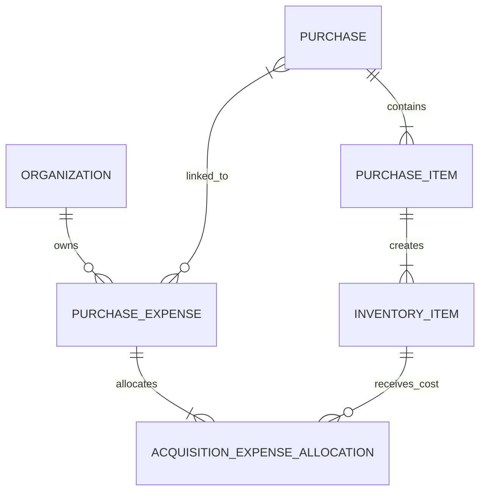

# storage-minis v0.7 — shared PurchaseExpense impact

**Version:** 0.7. **Decision date:** 2026-10-21.

**Baseline:** [#82](https://github.com/WilliamPhilippe/storage-minis-be/issues/82). [Requirements](requirements-v0.7.md) · [Entities](entity-map-v0.7.md) · [Ownership](requirements-coverage-v0.7.md).

## Accepted behavior

P1 has I1/I2; P2 has I3/I4. If I1 and I4 arrive together, one PurchaseExpense can cover them across both Purchases. The expense belongs to their Organization and links to both Purchases. Its amount goes directly to the selected InventoryItems.

For R$30 shipping, allocate R$10 to I1 and R$20 to I4. I2 and I3 receive none. Purchase expense subtotals are R$10/R$20; the actual source and settlement remain R$30 once. Each unit may receive further allocations from other expenses.

Purchase links identify context. Costs are stored in unit allocations. A physical association table may store the many-to-many links, or they may derive from allocations with equivalent guarantees; it has no independent monetary allocation.

## Requirement propagation

- Amend 15 existing IDs: REQ-006; INV-011; PUR-013–014, PUR-016, PUR-018–022, PUR-024, PUR-035; FIN-001–002; COL-009.
- Add PUR-047 for PurchaseExpense identity/Organization and many-to-many Purchase context; PUR-048 for same-Organization unit targets and link consistency; PUR-049 for atomic changes, source preservation and protected costs.
- 307 active requirements; nine previously retired IDs; no ID reuse or new retirements. All other v0.6 decisions carry forward.

## Backlog propagation

| Tickets | Required change |
| --- | --- |
| #6, #37 | Extend existing acquisition-cost epic/expense delivery: shared source, selected units across Purchases, one settlement, exact global reconciliation, isolation and link consistency. |
| #21, #24 | Model the relationship and selected-unit rounding basis; avoid Purchase-header allocation. |
| #38 | Receipt evaluates only each selected unit's applicable settled expenses. |
| #39, #50, #20, #67 | Preserve shared source/history and unaffected allocations during removal/cancellation; decide exceptional or unresolved disposition under D06. |
| #40, #41, #43 | Unit-specific costs, correct confirmed-zero/completion checks, independent progress and preservation of every completed-Purchase/finalized-unit lock. |
| #45, #59 | Derive Purchase subtotals and count expense/settlement sources once; no double acquisition-cost deduction. |
| #75 | Cover all new acceptance scenarios and ownership of all 307 active requirements. |

All 75 current work items reference v0.7, with refreshed source excerpts and ownership where affected. Existing identities, parents, dependencies, statuses, priorities, assignees and milestones are preserved. #37 is expanded instead of creating a second expense implementation issue. The v0.5/v0.6 baselines remain historical, and the Project views/README identify v0.7.

## Preserved boundaries and open policy

SaleExpense stays owned by one Sale. Global Product scope, one collection unit per Organization/Product, credit exclusions and shared dated history are unchanged. Receipt still requires merchandise funding and paid applicable acquisition expenses. First sale approval remains the unit cost-lock trigger.

Completing P1 does not freeze eligible changes confined to P2, but any change must preserve P1's completed facts, finalized unit costs and source reconciliation. Removal/cancellation does not delete shared sources or silently move costs to other units. D06 must decide exceptional corrections and unresolved expense settlement/disposition; no new refund, loss or unlock policy is approved. D01–D08 remain open, including never-approved collection cost finalization (D08).

This change requires no separate Shipment, package workflow, expense-payment batching or general operating-expense module.

## Verification scope

Verify active requirement ownership and live source excerpts, many-to-many cardinality, selected-unit and rounding examples, organization isolation, no duplicated expense/cash totals, and preserved Project fields/relationships. Check historical documents and baseline issues are unchanged. These are documentation/backlog checks; the repository has no implemented application workflows to accept yet.
